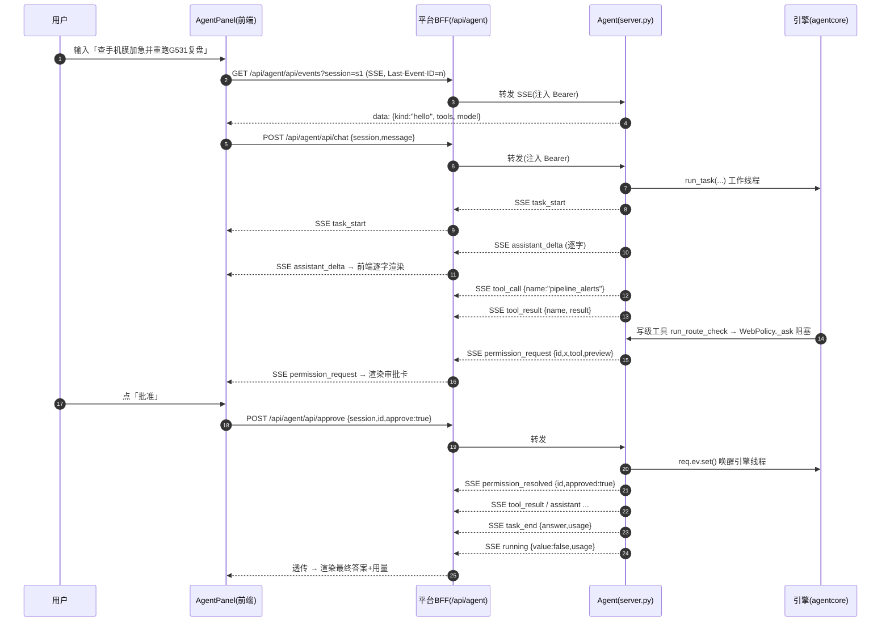
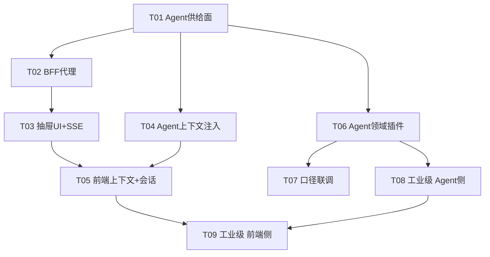

# AI 助手嵌入实现方案

> 目标：把用户自研的通用 Agent（`C:\Users\dell\Desktop\Agent`）嵌进数据后台系统前端（`D:\Desktop\work-main\数据后台系统`），
> 做成一个「懂当前屏幕、能查真实数据」的 AI 助手；并借着这个过程**逐步测试 Agent、把它推向工业级**。
>
> 版本：v1 · 定位：可直接照着实施的落地方案（结论先行 / 事实带 `文件:行号` 依据）。
> 说明：本方案为**只读调研 + 方案输出**，未修改任何代码文件。

---

## 0. 术语与两个系统

| 简称 | 指代 | 技术栈 | 入口 |
|------|------|--------|------|
| **平台** | 数据后台系统 `D:\Desktop\work-main\数据后台系统` | FastAPI(:8000) + React/Vite(:5173) + MUI | `python start.py`（`start.py:17-33`） |
| **Agent** | 用户自研通用 Agent `C:\Users\dell\Desktop\Agent` | agentcore 引擎 + FastAPI Web 适配器(:8765) | `python server.py`（`server.py:10-13`） |

平台 = 用户日常用的运营数据后台（左侧导航 20 页，`App.jsx:63-86`）。
Agent = 一个「引擎 + 多前端」的通用 agent（`agentcore.py:1-23`），已有 Web 适配器、SSE、审批闭环、领域插件。

---

## 1. 可行性结论（结论先行）

> **有条件能。** 技术链路完全具备——Agent 侧已有一套可直接复用的 HTTP+SSE+审批闭环 API（`server.py:463-865`），平台侧已有可承载抽屉面板的唯一布局（`App.jsx`）。
> **唯一的关键约束不是技术，而是两条硬边界：**
> 1. **平台「数据不出外网」约定**（`App.jsx:247` 侧栏文案原话）**与** Agent 默认把上下文发往云端 `https://api.z.ai/...`（`config.json:2-4`）**正面冲突** —— 必须先在方案层解决（详见 §8）。
> 2. **跨源 Cookie(`samesite=lax`) + Agent 侧零 CORS**（`server.py:322` 且全文无 `CORSMiddleware`）—— 浏览器直连会失败，必须靠拓扑选择绕开（详见 §2）。

结论：**技术可行，但有条件** —— 条件是在拓扑上选「同源 BFF 代理」、在数据流上先定「本地模型 / 分级授权」策略，然后分 4 阶段（P0→P3）推进。

---

## 2. 推荐拓扑（3 个候选对比）

### 2.1 候选 A：iframe 内嵌 Agent 自带页（零改造）

把 `http://127.0.0.1:8765/`（`server.py:380-382` 返回 `static/index.html`）直接放进平台抽屉的 `<iframe>`。

| 维度 | 结论 |
|------|------|
| **代价** | ≈0（前端加一个 iframe 即可） |
| **风险（致命）** | ① **第三方 Cookie 被拦**：Agent 登录 Cookie 是 `samesite="lax"`（`server.py:322`），放在跨源 iframe 里属第三方 cookie，现代浏览器默认**不发送** ⇒ 一旦 Agent 开启鉴权，iframe 内始终未登录、`/api/*` 全 401、`/` 307 跳 `/login`（`server.py:295-298`）。② **上下文注入极难**：平台当前 `page/category/batch` 只能靠 `src` 拼参或 `postMessage` 桥，Agent 自带页并不认这些参数。③ **鉴权模式受限**：改 `samesite=None` 需 `Secure`，而本机是 `http://`，做不到。④ UI 完全割裂（双滚动条、两个视觉体系）。 |
| **适用阶段** | 仅适合「**今天就想看一眼 Agent 长什么样**」的临时演示；一旦开鉴权就断。**不进正式路线。** |

### 2.2 候选 B：平台后端作 BFF 反向代理 + 前端原生 React 抽屉（同源）★推荐

平台 FastAPI 新增一个 `/api/agent/*` 代理路由，用 `httpx` 转发到 `127.0.0.1:8765`，**由服务端注入 `Authorization: Bearer <静态token>`**；SSE 用 `StreamingResponse` 原样透传；前端面板走**相对路径** `/api/agent/*`。

| 维度 | 结论 |
|------|------|
| **代价** | 中：后端加 ~1 个 router（转发 + SSE 透传 + 鉴权注入）、前端加抽屉面板（约 4-6 个组件/hook）。 |
| **风险** | ① SSE 经两层 FastAPI 需**禁用缓冲/压缩**（Agent 已带 `X-Accel-Buffering: no`，`server.py:863-865`；BFF 透传时要保头、且平台**不得**再有 Gzip 中间件）。② 代理需正确透传 `Last-Event-ID` 请求头（`server.py:835`）以支持断线重放。 |
| **优势** | ① **同源** ⇒ 无 CORS、无第三方 Cookie、无 `EventSource` 不能带鉴权头的坑（`EventSource` 无法自定义 header，直连方案 C 会撞上）；② **天然可注入上下文**（BFF 能从平台态取 `page/category/batch/sku` 塞进请求头/消息，见 §5）；③ **鉴权与审计唯一收口**在平台后端，前端永不接触 Agent token；④ dev 下 `/api` 已被 vite 代理到 8000（`vite.config.js:19-24`），挂到 `/api/agent/*` **前端零改动**即可开发。 |
| **适用阶段** | **起点（P0）与终态（P3）都推荐。** |

### 2.3 候选 C：浏览器直连 :8765（给 Agent 加 CORS + Bearer token）

前端直接 `fetch('http://127.0.0.1:8765/api/...')`，Agent 侧加 `CORSMiddleware`，用 `auth.tokens` 静态 Bearer（`server.py:68,114-121`）。

| 维度 | 结论 |
|------|------|
| **代价** | Agent 改代码（加 CORS，小），前端带 `Authorization` 头（中）。 |
| **风险（致命）** | ① **`EventSource` 不支持自定义请求头** —— 而 `/api/events`(SSE, `server.py:831`) 无法用 `EventSource` 带 Bearer；只能用 `fetch + ReadableStream` 手搓 SSE 解析（成本高、易错），或回退到 Cookie（又回到第三方 Cookie 问题）。② **token 落到前端**（安全差，且与「逐步工业级」目标背离）。③ 每加一个来源都要改 Agent 的 CORS 白名单。 |
| **适用阶段** | 仅当 Agent 与平台**必须异域部署**且无法放 BFF 时的备选。**不作为路线。** |

### 2.4 选型结论

| 项 | 选择 | 理由 |
|----|------|------|
| **起点（P0）** | **B（BFF 反代最小版 + 原生抽屉）** | 同源、零 CORS 坑、零前端改造即可复用现有 `/api` 代理；且 BFF 是从第一天就要有的「鉴权/审计/上下文注入」收口，早做早省事。 |
| **终态（P3）** | **B（BFF 增强：+ 上下文注入 + 领域插件 + 工业级要素）** | 工业级要求的 RBAC、审计、限额、多用户隔离，全都天然落在 BFF 这一层。 |
| **A** | 一次性临时手段（可选） | 若需当天演示，可先 iframe 看效果，随后**立刻切 B**；不并入路线。 |
| **C** | 否决 | `EventSource`+Bearer 冲突、token 暴露。 |

> 一句话：**永远走 B；A 只是「先看一眼」的临时窗口，C 不用。**

---

## 3. 分阶段路线 P0 → P3

> 约定：**前端任务** = 改平台（`数据后台系统/frontend` 与 `backend`）；**Agent 侧任务** = 改 Agent（`C:\Users\dell\Desktop\Agent`，用户拿这份清单去让 agent 实现）。P0 不含后端代理的复杂鉴权，只跑通链路。

### P0 · 打通链路（能问答 + 流式 + 审批）

| 项 | 内容 |
|----|------|
| **目标** | 平台右下角/右侧抽屉打开助手 → 输入 → 看到**流式回答** → 触发写工具弹出**审批卡** → 批准继续 / 拒绝生效。 |
| **可测验收标准** | ① 抽屉可开合，不破坏现有 20 页布局；② 发「手机膜有哪些批次」，能逐字看到流式 token（非一次性弹出）；③ 让助手跑 `run_route_check`（写级，`workmain.py:573-581`）能弹出审批卡；批准→继续、拒绝→助手收到 denied 并结束；④ `/api/agent/health` 返 `{status:"ok"}`。 |
| **前端任务** | 1) 后端 `backend/app/routers/agent_proxy.py`：`/api/agent/{path:path}` 转发到 `:8765`，注入静态 Bearer，SSE 透传（保 `X-Accel-Buffering`、透传 `Last-Event-ID`）。2) 在 `main.py` 注册该 router（`main.py:56-76` 附近）。3) 前端 `components/AgentPanel.jsx`（右抽屉）+ `AgentMessageList.jsx` + `AgentComposer.jsx` + `ApprovalCard.jsx` + `hooks/useAgentStream.js`（`fetch+ReadableStream` 解析 SSE）。4) `App.jsx` AppBar 加「AI 助手」开关按钮 + 挂载面板（`App.jsx:206-217`）。 |
| **Agent 侧任务** | 1) 在 `config.json → auth.tokens` 配一个**静态 token**（`server.py:68`）供 BFF 注入；确认本机模式或 token 模式二选一。2) 确认 `/api/events`：SSE 帧格式 `id: <seq>\ndata: <json>\n\n`（`server.py:841-842`）、`hello` 事件（`server.py:846-848`）、`X-Accel-Buffering: no`（`server.py:863-865`）保持稳定。3) （可选，稳健性）即便走 BFF，也建议给 `server.py` 加一个**默认关闭、可配置白名单**的 `CORSMiddleware`，为将来异域/本地调试留后路。4) 提供 `/api/health`（已有，`server.py:793`）。 |
| **风险** | BFF ↔ Agent 之间的流式透传（缓冲/超时）是 P0 最可能翻车点——验收③必须真跑通。 |

### P1 · 上下文感知 + 会话管理

| 项 | 内容 |
|----|------|
| **目标** | 助手「懂当前屏幕」：自动带上平台 `page / category / batch / 选中SKU`；支持会话列表/历史、停止、运行中追加指令、断点续跑。 |
| **可测验收标准** | ① 切到「加急预警」页问「这一页最急的几单」，回答**体现当前 `category`+`batch`**；② 运行中点「停止」，任务优雅停止（`server.py:563-578`）；③ 刷新浏览器后审批卡能按 `/api/pending`（`server.py:627-632`）重建；④ 侧栏能列出并切换会话（`/api/sessions`，`server.py:385`）。 |
| **前端任务** | 1) `ContextCollector`：从 `App.jsx` 现有 state（`page/batch/category`，`App.jsx:137-140`）与各页「选中SKU」汇聚上下文；2) BFF 在转发时把上下文写入请求头（如 `X-Plat-Context`）或前置进 message；3) 前端会话侧栏（拉 `/api/agent/sessions`、`/api/agent/sessions/{name}/history`）；4) 停止/追加指令按钮（`/api/agent/stop`、`/api/agent/enqueue`）。 |
| **Agent 侧任务** | 1) 支持从**请求头注入平台上下文**：`/api/chat` 读取 `X-Plat-Context`，在任务起步时拼接进 system/首条消息（改 `server.py:463-510` 与 `agentcore.run_task` 的起点）。2) 维护 `AGENT.md`（放**稳定知识**：页面字典、工具使用规范、口径纪律——见 §5）。3) 确认 `/api/enqueue`(640)、`/api/stop`(563)、`/api/interrupted`(521)、`/api/resume`(543)、`/api/resume/discard`(556) 在嵌入场景可用。 |
| **风险** | 上下文里若夹带敏感值（如负责人手机号），会随消息上云 —— 依赖 §8 的数据策略先行。 |

### P2 · 领域能力（只读真实数据）

| 项 | 内容 |
|----|------|
| **目标** | 助手能查**平台真实数据**（批次/SKU路线/加急预警/运输闭环/事中日报），而不是让 Agent 去读 xlsx 副本（现状 `workmain.py` 就是读 xlsx，存在口径漂移与新鲜度问题）。 |
| **可测验收标准** | ① 问「G531 现在卡在哪」，命中 `platform_sku_route` 且**数字与平台「SKU 档案/路线达标」页一致**；② 问「手机膜今天加急的」，命中 `platform_alerts` 且与「加急预警」页一致；③ 全程**只读**（无写工具被触发）。 |
| **前端任务** | 基本无（P1 已把筛选上下文注入）；如产品要求，补：把「当前页筛选条件」一并进上下文。 |
| **Agent 侧任务** | 新增 workmain 插件**只读工具**，对接平台后端：`platform_batches / platform_overview / platform_sku_route / platform_alerts / platform_transport / platform_records / platform_inflight_overview / platform_inflight_alerts / platform_daily_report / platform_deltas`（schema 见 §6）。这些工具统一 `level="read"`。 |
| **风险** | 口径一致性：Agent 侧工具必须**直连平台后端 API**（唯一真源），**禁止**再各读一份 xlsx，否则又出现「两份实现漂移」。 |

### P3 · 工业级要素

| 项 | 内容 |
|----|------|
| **目标** | 鉴权 / RBAC / 审计留痕 / 用量与成本限额 / 可观测 / 错误降级 / SSE 断线续传 / 审批 UX / 多用户隔离 全面到位（逐条见 §7）。 |
| **可测验收标准** | ① 未授权用户不能调写工具；② 每次写/对外操作在 SQLite 有审计行（`server.py:158,195,220` 已有 `storage.approval` 雏形）；③ 超并发/超 RPM 有明确降级而不是 500（`config.json:36-42` 已有 `limits`）；④ `/api/metrics` 可被 scrape（`server.py:801`）；⑤ SSE 断线后自动重连且不丢事件（`Last-Event-ID` 重放，`server.py:835-852`）。 |
| **前端任务** | 多用户身份透传（见 §7 现状）、用量/成本展示、断线重连提示、审计查看入口（可选）。 |
| **Agent 侧任务** | RBAC（工具级+用户级）、审计写 SQLite、token 用量与限额、Prometheus 指标完善、熔断降级、多用户会话命名空间（`server.py:366-373` 已有 `user@session` 雏形）。 |
| **风险** | 平台当前**无登录/多用户体系** —— 「多用户隔离」在平台侧缺地基，需要先补平台身份再谈 Agent 侧隔离（列为决策点 §9-5）。 |

---

## 4. 接口契约

> 以下均以「BFF 前缀 `/api/agent`」书写；实际 Agent 原生路径为 `/api/...`（去掉前缀）。前端只认 `/api/agent/*`（同源）。

### 4.1 面板要用的端点清单

| 方法 | BFF 路径（→ Agent 路径） | 请求体 / 参数 | 成功响应 | 错误码 | 依据 |
|------|--------------------------|---------------|----------|--------|------|
| POST | `/api/agent/api/login` → `/api/login` | `{username, password}` | `{ok,user}` + Set-Cookie | 401 | `server.py:313-323` |
| POST | `/api/agent/api/logout` → `/api/logout` | — | `{ok:true}` | — | `server.py:326-330` |
| GET | `/api/agent/api/me` → `/api/me` | — | `{user, auth}` | — | `server.py:333-335` |
| POST | `/api/agent/api/chat` → `/api/chat` | `{session, message, reflect=False, plan=False, stepwise=False}` | `{ok:true}`（真正结果走 SSE） | 400 空消息 / 409 运行中 / 503 并发满 | `server.py:463-510`（ChatBody `343-349`） |
| GET | `/api/agent/api/events` → `/api/events` | `?session=`（SSE，透传 `Last-Event-ID`） | `text/event-stream` | — | `server.py:831-865` |
| POST | `/api/agent/api/approve` → `/api/approve` | `{session, id, approve, always=False, text=""}` | `{ok:true}` | 404 不存在/跨用户 | `server.py:581-595`（ApproveBody `351-356`） |
| POST | `/api/agent/api/approve_batch` → `/api/approve_batch` | `{session, ids:[...], approve, text=""}` | `{ok, resolved:[], missing:[]}` | — | `server.py:605-624` |
| GET | `/api/agent/api/pending` → `/api/pending` | `?session=` | `{items:[{id, tool, preview}]}` | — | `server.py:627-632` |
| POST | `/api/agent/api/stop` → `/api/stop` | `{session}` | `{ok, stopping}` | — | `server.py:563-578` |
| POST | `/api/agent/api/enqueue` → `/api/enqueue` | `{session, text}` | `{ok:true}` | 400 空/未运行 | `server.py:640-653` |
| GET | `/api/agent/api/sessions` → `/api/sessions` | — | `[{name, size, mtime}]` | — | `server.py:385-428` |
| GET | `/api/agent/api/sessions/{name}/history` → `.../history` | — | `{items:[...], usage, running}` | — | `server.py:431-456` |
| POST | `/api/agent/api/sessions/{name}/rename` → `.../rename` | `{new}` | `{ok, name}` | 400/404/409 | `server.py:751-769` |
| DELETE | `/api/agent/api/sessions/{name}` → `.../{name}` | — | `{ok:true}` | 404/409 | `server.py:772-790` |
| GET | `/api/agent/api/interrupted` → `/api/interrupted` | — | `{items:[...]}` | — | `server.py:521-536` |
| POST | `/api/agent/api/resume` → `/api/resume` | `{session}` | `{ok:true}`（复用 chat 全链路） | 404 | `server.py:543-553` |
| POST | `/api/agent/api/resume/discard` → `.../resume/discard` | `{session}` | `{ok:true}` | — | `server.py:556-560` |
| POST | `/api/agent/api/files/upload` → `/api/files/upload` | multipart `file` | `{ok, path, size}` | 413 超 50MB | `server.py:664-682`（`MAX_UPLOAD` 48） |
| GET | `/api/agent/api/files` → `/api/files` | `?path=.` | `{items:[...]}` | 400 | `server.py:685-713` |
| GET | `/api/agent/api/files/download` → `.../download` | `?path=` | 文件 | 403 敏感/404/400 | `server.py:716-726` |
| GET | `/api/agent/api/files/raw` → `.../raw` | `?path=` | 内联文件 | 403/404/400 | `server.py:729-740` |
| GET | `/api/agent/api/health` → `/api/health` | — | `{status, model, sessions, running}` | — | `server.py:793-798` |
| GET | `/api/agent/api/metrics` → `/api/metrics` | — | Prometheus 文本 | — | `server.py:801-828` |

### 4.2 SSE 事件类型与 payload schema

> 事件由「`emit(kind, data)`」产生（引擎侧 `agentcore.py:10-19` + `server.py`）。帧格式：`id: <seq>\ndata: <json>\n\n`（`server.py:841-842`）；`kind != "assistant_delta"` 的事件才进重放日志（`server.py:248-249`）；`/api/events` 起始先发一条**无 id 的 `hello``（`server.py:846-848`）。

**引擎事件（`agentcore.py`）**

| `kind` | payload 字段 | 触发 | 行号 |
|--------|--------------|------|------|
| `task_start` | `{task}` | 任务开始 | `agentcore.py:1275` |
| `assistant_delta` | `{text}` | 流式增量（**不入重放日志**） | `agentcore.py:1307` / `server.py:248` |
| `assistant` | `{text}` | 一段完整助手文本 | `agentcore.py:1317` |
| `tool_call` | `{name, args}`（args 为截断 JSON 串） | 发起工具调用 | `agentcore.py:1342` |
| `tool_result` | `{name, result}`（已截断） | 工具返回 | `agentcore.py:1366` |
| `permission_denied` | `{name}` | 策略拒绝（非审批） | `agentcore.py:1358` |
| `injection_suspected` | `{name, marker}` | 疑似提示注入 | `agentcore.py:1365` |
| `compact` | `{tokens, dropped}` | 上下文压缩 | `agentcore.py:1100` |
| `instruction_injected` | `{text}` | 中途追加指令被注入 | `agentcore.py:1217` |
| `reflect` | `{critique}` | 反思结论 | `agentcore.py:1423` |
| `fix_round` | `{critique}` | 反思修正轮 | `agentcore.py:1458` |
| `plan` | `{plan}` | 计划文本 | `agentcore.py:1515` |
| `plan_extra` | `{extra}` | 计划附加要求 | `agentcore.py:1532` |
| `plan_approved` | `{}` | 计划获批 | `agentcore.py:1533` |
| `plan_rejected` | `{plan}` | 计划被拒 | `agentcore.py:1512,1522` |
| `steps` | `{steps}` | 分步列表 | `agentcore.py:1537` |
| `step_done` | `{step, total, text}` | 单步完成 | `agentcore.py:1552` |
| `plan_stopped` | `{at, total}` | 计划中途停止 | `agentcore.py:1541,1561` |
| `task_end` | `{answer, usage}` | 任务结束（usage=累计 token） | `agentcore.py:1296,1326` |
| `cancelled` | `{}` | 被取消 | `agentcore.py:1294,1375` |
| `max_turns` | `{}` | 超最大轮次 | `agentcore.py:1381` |
| `fatal` | `{message}` | 不可重试错误 | `agentcore.py:1311` / `server.py:501` |

**Web 适配器事件（`server.py`，`emit_threadsafe`/`send`）**

| `kind` | payload 字段 | 触发 | 行号 |
|--------|--------------|------|------|
| `hello` | `{kind:"hello", tools:[...], model, root}` | `/api/events` 首帧（**无 seq/id**） | `server.py:846-848` |
| `running` | `{value:true}` / `{value:false, usage}` | 任务起/止 | `server.py:474,504-505` |
| `permission_request` | `{id, tool, preview}` | 写级工具待审批（**渲染审批卡**） | `server.py:154-156` |
| `permission_resolved` | `{id, approved}` | 审批被解决 | `server.py:577,594,623` |
| `plan_request` | `{id, plan}` | 计划待审批 | `server.py:192-193` |
| `step_request` | `{id, step, total, text}` | 分步待确认 | `server.py:215-217` |
| `instruction_queued` | `{text}` | 追加指令入队 | `server.py:652` |

> ⚠️ 面板实现注意：`hello` **无 id**（不能用于 `Last-Event-ID`）；`assistant_delta` 会**大量**产生但不重放——重连后靠完整 `assistant` 事件复原（`server.py:245-246`）。`running.value=false` 携带 `usage`，是前端刷新「用量」的信号。

### 4.3 一次「提问 → 流式 → 审批 → 继续」完整时序



---

## 5. 上下文注入方案（让助手「懂当前屏幕」）

要注入的上下文 = 平台当前态：`page`（当前页 key，`App.jsx:137`）、`category`（品类，`App.jsx:140`）、`batch`（批次，`App.jsx:138`）、`选中SKU`（各页局部 state，如 SKU 档案页选中的 code）。

| 方案 | 做法 | 优点 | 缺点 |
|------|------|------|------|
| ① Prompt 前缀 | BFF 在 `message` 前置 `[平台上下文] page=alerts category=手机膜 batch=...` | 零 Agent 改动、最快 | 污染会话历史；每轮重复；对用户半可见，观感差 |
| ② `AGENT.md` / 专用 system prompt | Agent 侧维护一份静态说明（页面字典、工具规范、口径纪律） | 结构化、可版本化、**适合稳定知识** | **静态**，装不下「当前屏幕」这种动态值 |
| ③ 请求头注入（**推荐**） | BFF 从平台态生成 `X-Plat-Context: {json}`；Agent 端 `/api/chat` 读取后，在**任务起步**拼进 system 或首条 user | 与消息解耦、干净、可审计；BFF 是唯一注入点 | 需 Agent 端支持读 header 并注入（改 `server.py:463` + `run_task` 起点） |
| ④ 专用插件工具 | 新增 `platform_context` 工具让 agent 主动取 | 显式、可控制 | 多一轮往返；agent 可能不调 |

**推荐组合：③ 为主 + ② 为辅 + ① 兜底。**

- **③ 动态上下文**：BFF 负责采集 `page/category/batch/sku` → 写 `X-Plat-Context` 头 → Agent 在**每轮任务起点**注入（不进持久历史，避免污染）。上下文是「当前屏幕」，天然属于**每轮请求**而非**会话**。
- **② 稳定知识**：`AGENT.md` 放「20 个页面各是什么 / 各工具何时用 / 两套复盘口径不可混用（`workmain.py:536-542` 已有此纪律）/ 数据新鲜度告警怎么读」这类**不随屏幕变**的内容。
- **① 兜底**：仅当某页有个性化参数（如 Records 页的 `part/status/keyword` 筛选）需要临时带上时，用一次性前缀补，不进历史。

> 关键纪律：**动态值走请求头、静态知识走 `AGENT.md`、绝不把动态值写进持久会话历史**——否则历史会被历史上下文塞满、且换页后残留旧上下文造成误导。

---

## 6. 领域能力契约（P3 工业级 · 只读）

**原则：Agent 侧领域工具一律直连平台后端 API（`:8000`，唯一真源），只读、不读 xlsx 副本。**

### 6.1 插件注册草案（`plugins/workmain.py` 增补）

```jsonc
// 每个工具 = registry.register(Tool(name, description, params_schema, level, fn))
{
  "name": "platform_batches",
  "description": "列出平台当前品类的所有数据批次（唯一真源，替代直接读 data/ 目录）。",
  "params": {"type":"object","properties":{
      "category":{"type":"string","enum":["手机膜","手机壳"]}},"required":[]},
  "level": "read"
}
{
  "name": "platform_sku_route",
  "description": "查某 SKU 的平台复盘现状（各 Part 实际vs目标、三部门终节点、卡点）。数据与平台『SKU档案/路线达标』页同源。",
  "params": {"type":"object","properties":{
      "sku":{"type":"string"},"caliber":{"type":"string","enum":["action","system"]}},
      "required":["sku"]},
  "level": "read"
}
{
  "name": "platform_alerts",
  "description": "平台加急预警（P0/P1/P2 明细 + 盯数清单 + 数据新鲜度，route_check_sys 口径）。与『加急预警』页同源。",
  "params": {"type":"object","properties":{
      "category":{"type":"string","enum":["手机膜","手机壳"]},
      "priority":{"type":"string","enum":["P0","P1","P2"]}},"required":[]},
  "level": "read"
}
{
  "name": "platform_transport",
  "description": "平台货件运输看板（逐票判定 + 渠道/运输方式聚合），用于运输闭环问答。",
  "params": {"type":"object","properties":{
      "category":{"type":"string","enum":["手机膜","手机壳"]}},"required":[]},
  "level": "read"
}
{
  "name": "platform_records",
  "description": "平台明细分页查询（按批次/Part + 审批号/创建人/状态/关键词过滤）。",
  "params": {"type":"object","properties":{
      "batch":{"type":"string"},"part":{"type":"string"},
      "page":{"type":"integer","minimum":1},"pageSize":{"type":"integer","minimum":1},
      "approvalNo":{"type":"string"},"creator":{"type":"string"},
      "status":{"type":"string"},"keyword":{"type":"string"}},
      "required":["batch","part"]},
  "level": "read"
}
{
  "name": "platform_inflight_overview",
  "description": "平台事中总览：在研 SKU 清单 + KPI（T03）。",
  "params": {"type":"object","properties":{
      "category":{"type":"string","enum":["手机膜","手机壳"]}},"required":[]},
  "level": "read"
}
{
  "name": "platform_inflight_alerts",
  "description": "平台事中风险预警：当日新超期/持续超期/临近超期(85%)。",
  "params": {"type":"object","properties":{
      "category":{"type":"string","enum":["手机膜","手机壳"]}},"required":[]},
  "level": "read"
}
{
  "name": "platform_daily_report",
  "description": "平台事中日报列表 / 生成当日日报（生成=写级）。",
  "params": {"type":"object","properties":{
      "date":{"type":"string","description":"YYYY-MM-DD, 缺省=今天"},
      "generate":{"type":"boolean","description":"true=当日重跑生成"}},"required":[]},
  "level": "read"        // generate=true 时降级为 write，见下
}
{
  "name": "platform_deltas",
  "description": "平台单据增量（未闭环 SKU 新增单据追踪，T10）。",
  "params": {"type":"object","properties":{
      "days":{"type":"integer","minimum":1},"sku":{"type":"string"}},"required":[]},
  "level": "read"
}
{
  "name": "platform_overview",
  "description": "平台批次总览 KPI。",
  "params": {"type":"object","properties":{
      "batch":{"type":"string"},"category":{"type":"string","enum":["手机膜","手机壳"]}},
      "required":["batch"]},
  "level": "read"
}
```

**映射到平台只读 API**（均见 `api.js`）：

| 工具 | 平台 API | `api.js` 依据 |
|------|----------|---------------|
| `platform_batches` | `GET /api/batches?category=` | `api.js:38-40` |
| `platform_overview` | `GET /api/overview/{batch}` | `api.js:42-45` |
| `platform_sku_route` | `GET /api/routes` / `GET /api/review/sku/{code}` | `api.js:96-98,111-114` |
| `platform_alerts` | `GET /api/alerts` | `api.js:131-134` |
| `platform_transport` | `GET /api/transport` | `api.js:121-124` |
| `platform_records` | `GET /api/records/{batch}/{part}` | `api.js:70-83` |
| `platform_inflight_overview` | `GET /api/inflight` | `api.js:317-320` |
| `platform_inflight_alerts` | `GET /api/inflight/alerts` | `api.js:327-330` |
| `platform_daily_report` | `GET/POST /api/inflight/daily-report` | `api.js:339-353` |
| `platform_deltas` | `GET /api/deltas` | `api.js:379-381` |

> 说明：`platform_daily_report(generate=true)` 会**写**（生成日报，`api.js:339-342`），其余全只读。**写能力默认不开放**；若开放，必须走审批+审计（见 §7、§8）。

---

## 7. 工业级要素清单（现状 vs 差距 vs 归属）

| # | 要素 | 现状（依据） | 差距 | 归属 |
|---|------|--------------|------|------|
| 1 | **鉴权** | Agent 有：HMAC Cookie + 静态 Bearer，`users/tokens` 非空即开启（`server.py:61-74,108-123`）。平台**无登录**（`App.jsx` 无任何 auth） | Agent 侧已够用；缺口在**平台无身份** ⇒ 无法做用户级隔离 | **前端**（平台补身份） |
| 2 | **RBAC** | Agent 仅有「工具级 read/write/external」三级（`server.py:164-178`，`workmain.py` level 字段） | 缺**用户/角色级**授权（谁能批写、谁能看哪类数据） | **Agent**（主要）+ 前端透传角色 |
| 3 | **审计留痕** | 已有雏形：审批写 `storage.approval(...)`（`server.py:158-159,195-197,220-221`）；`storage` SQLite | 缺：读操作审计、平台侧审计、审计可查界面 | **Agent**（写库）+ 前端（查询入口） |
| 4 | **用量与成本限额** | 有：`limits.max_concurrent_tasks/llm_rpm/breaker`（`config.json:36-42`）；`/api/metrics` 报 token（`server.py:801-828`）；`usage` 随 `task_end/running` 下发 | 缺：**按用户/会话的限额**、成本阈值拦截、超限友好提示 | **Agent**（主要）+ 前端（展示） |
| 5 | **可观测（日志·指标）** | 有：`core.log`、Prometheus `/api/metrics`（`server.py:801`） | 缺：嵌入链路的**端到端 trace**（请求经 BFF 的耗时、SSE 断连率） | **前端**（BFF 侧指标）+ **Agent** |
| 6 | **错误与降级** | 有：`fatal` 事件（`server.py:501`）、并发满 503（`server.py:471`）、熔断配置 | 缺：BFF 侧超时/断开时的**降级 UI**（重连、排队提示） | **前端**（UI）+ **Agent**（后端） |
| 7 | **SSE 断线续传** | 有：seq + `Last-Event-ID` 重放，每会话留 500 条（`server.py:47,238-239,835-852`） | 缺口：BFF 透传是否**保留 `Last-Event-ID` 头** + 前端是否**自动重连并带上 lastId** | **前端**（双方：BFF 透传 + 面板重连） |
| 8 | **审批 UX** | 有：审批卡数据 `permission_request`（`server.py:154-156`）、批量审批、external 双确认（`server.py:167-176`）、`/api/pending` 重建 | 缺口：前端未实现；多卡排队、键盘操作、超时策略 | **前端**（主）+ Agent（已有） |
| 9 | **多用户隔离** | Agent 有：`user@session` 命名空间（`server.py:366-373`）、按用户过滤会话（`server.py:389-397,531-534`） | 缺口：**平台无用户身份** ⇒ 无法产生稳定 `user` | **前端**（平台身份）+ Agent（已具雏形） |

---

## 8. 风险与不变量

### 8.1 跨源 Cookie(`samesite=lax`) 与 CORS

- **事实**：Agent 登录 Cookie 属性 `httponly=True, samesite="lax"`（`server.py:321-322`）；Agent **全文无 CORS**（无 `CORSMiddleware`/`allow_origins`）。`AuthGate` 对 `OPTIONS` 放行但**不返回 CORS 头**（`server.py:288-302`）。
- **不变量**：⇒ **不要试图让浏览器跨源直连 Agent**（方案 C 会撞「第三方 Cookie 不发送 + `EventSource` 不能带 Bearer」双坑）。
- **对策**：走 **BFF（方案 B）**，跨源问题在服务端消失；BFF 用**静态 Bearer**（`server.py:114-121`）注入，前端永不接触 token。

### 8.2 SSE 经反向代理的缓冲/超时坑

- **事实**：Agent 已设 `Cache-Control: no-cache` + `X-Accel-Buffering: no`（`server.py:863-865`）。
- **不变量（务必守住）**：
  1. BFF 透传时**必须原样保留** `text/event-stream` 与 `X-Accel-Buffering: no` 响应头；
  2. 平台后端**不得**全局启用 Gzip/压缩中间件（会缓冲 SSE）；
  3. `httpx` 转发用 **`stream=True`（异步流式）**，并设置**够长/无限**的读超时；
  4. 反向代理（若将来经 nginx）需 `proxy_buffering off; proxy_read_timeout` 加大。
- **验收**：P0 验收②「逐字流式」即验证此点。

### 8.3 Agent 写操作可能改到平台数据的边界

- **事实**：Agent 现有写级工具是 `run_route_check`，输出**隔离到 `agent_tmp`**、不覆盖正式产物（`workmain.py:501-522`）。平台侧存在真写接口：`PUT /api/rules`（`api.js:142`）、`POST /api/fillins`（`api.js:193`）、`POST /api/etl/import`（`api.js:289`）。
- **不变量 / 规则**：
  - **默认只读**：P2 的全部 `platform_*` 工具为 `read`；**不把平台写接口接给 Agent**。
  - 若要开放写：必须**同时满足**（a）工具 `level="write"` 走审批阻塞（`server.py:164-178`）；（b）写操作**留审计**（`storage.approval` / 新增 `storage.tool_audit`）；（c）**幂等 + 可回滚**（平台 `etl` 已有 backup，`api.js:294-301`，写前先备份）。
  - `external` 级（对外发送，如钉钉推送 `config.json:11`）保持**双确认且不吃总允许**（`server.py:167-176`）。

### 8.4 🔴 与平台「数据不出外网」约定的冲突（**必须正面处理**）

- **事实**：
  - 平台侧栏明写「**数据仅在本机处理，不出外网**」（`App.jsx:245-249`）。
  - Agent **默认**把上下文/工具结果发往**云端** `https://api.z.ai/api/paas/v4`（`config.json:2-4`），且可 `AGENT_API_KEY/AGENT_BASE_URL/AGENT_MODEL` 覆盖。
  - 一旦把「当前屏幕上下文 + 平台真实数据」交给助手，这些内容**会上云** —— 与平台承诺**直接冲突**。
- **至少 2 种对策**（建议组合，按敏感度分级）：

  | 对策 | 做法 | 适用 | 代价 |
  |------|------|------|------|
  | **① 仅本机/内网模型** | 把 `config.json → base_url` 指向本机/内网 OpenAI 兼容端点（如 vLLM / Ollama / LM Studio，如 `http://127.0.0.1:11434/v1`），数据**全程不出机** | 含真实数据的问答（P2 领域能力） | 需本机算力；模型能力可能弱于云端 |
  | **② 分级授权 + 脱敏 + 明确告知** | 按敏感度分级：**聚合/只读统计**可上云、**明细/个人信息**不出；对上云内容**脱敏**（去负责人手机号等）；UI **明确告知**「本次将把 X 类数据发送到云端」并需用户点确认 | 无法部署本机模型时的折中 | 需实现分级规则 + 脱敏 + 告知交互 |
  | ③ 云端仅做「无数据」任务 | 通用推理/文案/代码类走云，数据类走本机 | 混合 | 需按任务路由模型 |

- **推荐**：**① 为主**（数据类问答走本机模型）+ **③ 路由**（无数据任务可走云）+ **② 兜底**（本机算力不足时）。**P0/P1 就要把这条策略定下来**，不能等 P2 才想——否则链路一通就等于默认把数据发上云。

---

## 9. 决策记录（**2026-10-09 用户已确认**）

| # | 决策点 | **已定** |
|---|--------|----------|
| 1 | **嵌入拓扑** A/B/C | ✅ **B**（平台后端 BFF 反代 + 前端原生 React 抽屉）；A 仅作临时演示、C 否决 |
| 2 | **数据是否允许出本机** | ✅ **分级授权 + 脱敏 + 明确告知**（聚合/只读统计可上云；明细/个人信息不出；上云内容脱敏；UI 明确告知并需用户确认）。**不选"全部上云"、也不强制"全部本机"** |
| 3 | **助手对平台数据权限** | ✅ **P2 只读**；平台写接口（`rules`/`fillins`/`etl`）**不接给 Agent**，写能力默认不开放 |
| 4 | **鉴权模式** | ✅ **BFF 注入静态 Bearer**（`config.json→auth.tokens`），前端**永不接触** Agent token |
| 5 | **会话模型** | ✅ **按浏览器/用户一个「助手会话」**，上下文随屏幕（`page/category/batch`）每轮注入 |

### 9.1 决策 2 的落地要求（**新增，贯穿 P1/P2**）

> 因为选了"分级 + 脱敏 + 告知"，必须有一个**唯一的出站收口**，否则脱敏会被绕过。

- **收口位置 = BFF（`agent_proxy.py`）**：所有出站内容（上下文头 `X-Plat-Context` + 用户消息 + 工具结果回灌）**都经它** → 分级 → 脱敏 → 才转发给 Agent。
- **分级规则**：字段/实体级白名单。示例：批次号 / SKU / 机型 / 统计值 / 页面名 = **可上云**；负责人姓名·手机号 / 内部备注 / 联系方式类字段 = **不可上云（脱敏或剔除）**。
- **告知交互**：命中"将上云"时，面板显式提示「本次将把【X 类】数据发送至云端模型，是否继续」，需用户确认后才发送。
- **归属**：分级 + 脱敏 + 告知 = **前端侧**（BFF + 面板）→ 见 **T10**。

---

## 10. 任务分解（有序 · 带依赖 · 标注归属）

> 依赖说明：`T0x` 全表按实现顺序排列；P0 内前端/Agent 可并行，但 **T01（Agent 侧供给）先行**，否则前端无接口可调。

| 任务 | 名称 | 归属 | 依赖 | 优先级 | 涉及文件 / 内容 |
|------|------|------|------|--------|------------------|
| **T01** | Agent 供给面就绪：静态 token + 契约确认 | **Agent** | — | P0 | `config.json`（加 `auth.tokens`）；确认 `server.py` SSE/审批/事件契约稳定；可选加默认可配 CORS |
| **T02** | BFF 代理路由（转发 + SSE 透传 + Bearer 注入） | **前端** | T01 | P0 | `backend/app/routers/agent_proxy.py`（新）；`backend/app/main.py:56-76` 注册 router；确保无 Gzip 中间件 |
| **T03** | 助手抽屉 UI + SSE hook + 审批卡 | **前端** | T02 | P0 | `frontend/src/components/AgentPanel.jsx`、`AgentMessageList.jsx`、`AgentComposer.jsx`、`ApprovalCard.jsx`、`hooks/useAgentStream.js`（新）；`App.jsx:206-217` 挂入口 |
| **T04** | Agent 侧上下文注入能力（读 `X-Plat-Context`） | **Agent** | T01 | P1 | `server.py:463-510` `/api/chat` 读头注入；`agentcore.run_task` 起点注入；新增 `AGENT.md`（稳定知识/页面字典/口径纪律） |
| **T05** | 前端上下文采集 + 会话侧栏 + 停止/追加 | **前端** | T03,T04 | P1 | `ContextCollector`（从 `App.jsx:137-140` 取态）；会话侧栏调 `/api/agent/sessions`；停止/追加按钮调 `stop/enqueue` |
| **T06** | Agent 领域插件：对接平台只读 API | **Agent** | T01 | P2 | `plugins/workmain.py` 增补 `platform_*` 工具（§6 schema）；直连 `:8000`，全 `read` |
| **T07** | 口径一致性联调（Agent 工具 vs 平台页面数字） | **前端(+Agent)** | T06 | P2 | 对照 `api.js` 各页数字；确保无「各读一份 xlsx」漂移 |
| **T08** | 工业级：RBAC + 审计 + 限额 + 指标完善 | **Agent** | T06 | P3 | `server.py`/`storage.py`/`agentcore.py`：用户级授权、写审计、按用户限额、Prometheus 补指标、熔断降级 |
| **T09** | 工业级：多用户身份 + 断线重连 + 用量/成本展示 | **前端** | T05,T08 | P3 | 平台补身份体系；BFF 透传角色；面板实现 `Last-Event-ID` 自动重连；用量条 |
| **T10** | **数据分级 + 脱敏 + 出网告知**（决策 2 落地） | **前端** | T02,T05 | P1→P2 | `agent_proxy.py` 增出站分级/脱敏中间层（白名单：批次/SKU/机型/统计值放行；负责人姓名·手机号·内部备注剔除或掩码）；`AgentPanel.jsx` 增「本次将发送【X 类】数据至云端，是否继续」确认；口径见 §9.1 |

**依赖图**



---

## 附：本方案的关键事实速查（供工程师核对）

| 事实 | 依据 |
|------|------|
| Agent 已有完整 HTTP+SSE+审批 API | `server.py:313-865` |
| Agent SSE 帧 = `id: <seq>\ndata: <json>\n\n`；带 `X-Accel-Buffering: no` | `server.py:841-842,863-865` |
| Agent 登录 Cookie = `httponly, samesite=lax`；Bearer 支持静态 token | `server.py:321-322,114-121` |
| Agent **无 CORS** | `server.py` 全文（`AuthGate` `288-302` 不返回 CORS 头） |
| Agent 默认模型在云端 z.ai | `config.json:2-4` |
| Agent 写工具 `run_route_check` 输出隔离到 agent_tmp | `workmain.py:501-522` |
| 平台 CORS 只放行 5173/4173，`allow_credentials=False` | `main.py:46-54` |
| 平台布局唯一入口 = `App.jsx`；URL query 驱动（非 router） | `App.jsx:113-198` |
| 平台「数据不出外网」文案 | `App.jsx:245-249` |
| 平台前端相对 `/api`，dev 由 vite 代理到 :8000 | `api.js:12-20`；`vite.config.js:19-24` |
| 挂 `/api/agent/*` 可复用现有 vite 代理（前端零改） | `vite.config.js:19-24` |
