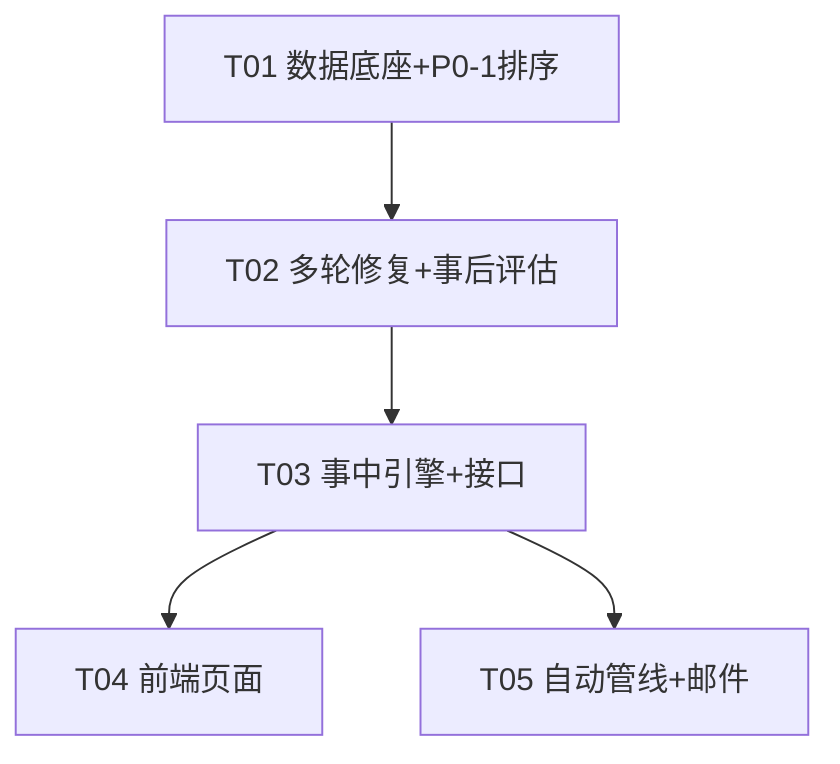

# 技术方案 — 流程事中管理与事后评估（process_inflight_review）

> 版本：v1.0 · 依据：PRD v0.2（5 项待确认全部关闭） · 权威口径：`backend/app/seg_rules.py` + PRD §1.2 G506 实测基准

## 1. 总体架构与改动面

### 1.1 路由前缀决策

**事中管理 → 新增 `/api/inflight/*`；事后评估 → 扩展 `/api/review/*`。**

理由：
- 事后评估（损益/三指标）强依赖复盘引擎已有的段级明细、货件配对、三部门终节点、`skuDetails` 与指纹缓存——直接挂在 `/api/review/*` 下可零成本复用 `get_review_data()` 的缓存与 prewarm 机制；
- 事中管理是全新状态域（在研 SKU、进行中段、85% 预警、每日快照 diff、上报清单），其 SKU 集合与复盘不同（**含"无任何已结束单据"的 SKU，复盘引擎现会过滤掉这类**），生命周期独立，新前缀避免污染 review 语义。

### 1.2 文件清单（新增 / 修改 / 复用）

| 类别 | 文件 | 说明 |
|---|---|---|
| 新增·后端 | `backend/app/routers/inflight.py` | /api/inflight/* 全部路由 |
| 新增·后端 | `backend/app/inflight_service.py` | 事中计算引擎（在研段状态、85% 预警、每日快照 diff、上报清单） |
| 新增·后端 | `backend/app/causal.py` | 核心原因因果链定位算法 |
| 新增·后端 | `backend/app/reporting.py` | xlsx 报告生成（每日复盘报告、SKU 核查报告甘特、事后评估报告） |
| 新增·后端 | `backend/etl/mailer.py` | SMTP 直连邮件试验通道（开关 + 当日去重）。落地时与 `auto_pipeline.py` 同层放在 `etl/` 包内 |
| 新增·后端 | `backend/etl/products_loader.py` | 商品资料.xlsx（评级档位+单价）导入 CLI |
| 新增·后端 | `backend/etl/auto_pipeline.py` | 自动管线：增量 ETL → 快照 → 日报 → 邮件（调度入口） |
| 新增·脚本 | `scripts/install_auto_etl.ps1` | PowerShell ScheduledTasks 注册（schtasks.exe 在本机黑名单） |
| 新增·测试 | `tests/test_review_rounds.py`、`tests/test_inflight.py` | G506 口径回归 + 事中引擎单测 |
| 新增·前端 | `frontend/src/pages/InflightDaily.jsx` | 「流程事中」页（P0-4/5/7、P1-1/2） |
| 新增·前端 | `frontend/src/pages/Assessment.jsx` | 「事后评估」页（P1-3/4） |
| 修改·后端 | `backend/app/routers/review.py` | ①多轮提交轮次配对修复 ②skuDetails 增加 rounds/multiRound/rootCause/assessment ③新 endpoint：checkreport / assessment / assessment/export |
| 修改·后端 | `backend/app/models.py` | 新增 `product_catalog` 表 |
| 修改·后端 | `backend/app/rule_service.py` | 新配置键 + RULE_META 中文说明（85% 系数、邮件开关、保留天数、损益口径） |
| 修改·后端 | `backend/app/routers/skus.py` | P0-1：立项时间倒序 + firstProposalAt 字段 |
| 修改·后端 | `backend/app/routers/dataadmin.py` | 新增 POST/GET `/api/etl/products` |
| 修改·后端 | `backend/app/main.py` | 注册 inflight 路由 |
| 修改·前端 | `frontend/src/App.jsx` | NAV_ITEMS/PAGES 各 +2 行（React.lazy，17→19 页） |
| 修改·前端 | `frontend/src/api.js` | 新 fetch 函数 |
| 修改·前端 | `frontend/src/pages/Review.jsx` | SKU 详情：多轮警示条、因果链、损益块、核查报告导出按钮 |
| 修改·前端 | `frontend/src/pages/Rules.jsx` | 新配置分组「事中预警 / 上报 / 损益口径」 |
| 修改·前端 | `frontend/src/pages/Skus.jsx` | 列表默认新→久 |
| 修改·脚本 | `scripts/scan_endpoints.py` | 探针列表补新接口（24 → **33** 个；条数 = 23 固定 + 4×批次数 + 6 个 `{code}` 模板） |
| 修改·脚本 | `frontend/scripts/browser_check.py` | 页面清单 17→19 |
| 复用 | review.py 的 `_load_sku_docs/dedupe_docs/extract_node_times/build_shipments`、history.py 快照模式、theme.js SEMANTIC、KpiCard/PageHeader/StateViews/SectionCard、hooks/useApi.js | 不另起炉灶 |

## 2. 数据层设计

### 2.1 商品资料（评级档位 + 单价）→ MySQL `product_catalog` 表

不建表到 state json：损益要对全量 SKU 做行内匹配、要支持"补售价后重导入重算"，表更合适，且 `Base.metadata.create_all` 已幂等建表。

```sql
CREATE TABLE product_catalog (
  sku        VARCHAR(128) PRIMARY KEY,   -- 与 part_doc.sku 同文本口径（trim 后精确匹配）
  model      VARCHAR(128),
  grade      VARCHAR(32),                -- 评级档位：XC / XB / …（A1 行说明档位含义）
  daily_min  DECIMAL(10,4),              -- 日均销量区间下限（XC=1.38）
  daily_max  DECIMAL(10,4),              -- 区间上限（XC=5.5）
  price      DECIMAL(12,4),             -- 单价（当前=参考成本价，G506=12.0266）
  price_type VARCHAR(32),               -- '参考成本价' | '售价'（资料表补售价列后切换，无需改代码）
  updated_at DATETIME
);
```

- **来源**：`C:\Users\dell\Desktop\work-main\资产文件\商品资料.xlsx`，路径写入 rule_config 键 `products_xlsx_path`（可配置，见 2.4）。A1 档位说明文本 + 每行 SKU 的评级列 / 参考成本价列。
- **导入入口**（两个，均复用同一 loader）：① CLI `python backend/etl/products_loader.py`；② 界面 `POST /api/etl/products`（数据管理页）。按文件 mtime+size 指纹增量，全量覆盖式导入。
- **匹配方式**：SKU `str.strip()` 后精确等值（18 位审批编号式陷阱不涉及；SKU 无精度问题）。未命中 SKU 在评估结果中显式标注 `productMatched: false`，不静默。
- **更新频率**：手动触发（商品资料变动不频繁）；导入后因 rule/数据指纹无关、product 表内容计入损益缓存指纹（见 §3.2）。

### 2.2 多轮提交的轮次模型（P0-3）

**不改表**——轮次是派生概念，每次计算时从 `part_doc` 现推：

- 同 SKU 同 Part 去重后（`dedupe_docs` 已有）的单据，按 `create_time` 升序编号为 R1..Rn；n≥2 即多轮提交场景。
- **取轮规则（2026-09-24 起，对齐 `流程复盘/route_check_sys.py`）**：同一 Part 多张单据时**统一取『最早一轮』**——逐列按 `create_time` 升序扫描、取**第一个非空值**（`_docs_oldest_first`，与 sys 的 `_rows_sorted(rows, oldest_first=True)` 同义）。改前口径为「基准轮 = 取数日期最贴近本单据创建时间的那一轮」+ `restrict` 限定单张单据，会把 `提案` 取成补报轮的时间。
  1. 于是 Part1 的 `提案`（创建时间列）取**最早那张单**，`取数`（手机数据取得日期列）取**最早一张填了取数日期的单** —— 二者同轮，或取数更早。注意是**逐列判定、不是整单绑定**：最早轮没填取数则取次轮那张（跨轮＝真实等待）；
  2. 多轮本身**必须显式标注**（PRD P0-3④「不可静默合并」）：`gapDays = 最晚轮创建日期 − 最早轮创建日期`（日历天差，与 sys `multi_round_note` 的 `max_gap` 同式——两个系统对同一件事报同一个数）；间隔 >0 天 → `flag=True, note='多轮提交·间隔 N 天·疑似漏报'`；间隔 =0 天 → `note='多轮提交 N 次·同日提交'`（不判异常）；
  3. 下游段（取数→签样→采购…）起点自然衔接最早轮取数，跨轮等待期原样保留为段耗时（G506 签样→采购 170 天得以呈现）。
- **G506 基准**：R1 2025-10-30 创建且当天完成取数；R2 2026-04-30 补报（其「手机数据取得日期」抄了 R1）。最早轮口径下 提案 = 取数 = 2025-10-30、「提案→取数」= **0 天**（改前为 **-182 天**反向段），同时 `gapDays = 182` 标「疑似漏报」，异常不被静默合并。
- **对外表达**：`skuDetails[code].rounds = [{round, part, approvalNo, createTime, status, hasData}]`；`multiRound = {flag, count, gapDays, note}`。派生数据不落库。
  - ⚠️ `multiRound` **只看 Part1**；sys 的「多轮提交」列覆盖 Part1~Part4/Part6/Part7（实测 Part2 另有 8 个 SKU 多单据、Part5/8/9 天然一渠道一单不计）。两侧口径尚未完全一致，见 §9 遗留项。
- `extract_node_times(restrict=)` 参数**已废弃**（原「轮次配对」的落地手段），业务路径（`compute_review` / `inflight_service`）不再传它；保留形参仅为兼容旧调用。
- 全量 SKU 校验：G506 全段 `days >= 0`；全量无「`提案→取数` < -60 天」的跨轮错配段（小于 60 天的负值是「先线下取数、后补录审批」的业务现实，保留）。

### 2.3 每日报告落盘与生命周期（P0-4）

- **路径**：`DATA_ROOT\<最新批次>\reports\事中日报_YYYYMMDD.xlsx`（日报覆盖全量在研 SKU，落"最新批次"目录，属已定假设，见 §8.4）。
  - ⚠️ **改名史（2026-09-24）**：原为 `复盘报告_YYYYMMDD.xlsx`，与单 SKU 的「复盘报告 md」撞名而内容其实是事中日报 → 改名。前缀常量 `_REPORT_PREFIX` / `_LEGACY_REPORT_PREFIX` 在 `inflight_service.py`；生成时会把**同一天**的旧名文件随迁删除（`_drop_legacy_report`），否则索引一换旧文件就成永久孤儿。
- **Sheets**：Sheet1 在研 SKU 状态总表（每 SKU 各段实际/目标/超期/状态：正常·进行中·超期）；Sheet2 超期明细（部门/段/责任人/超期天数）；Sheet3 风险预警（85% 即将超期）；Sheet4 今日进度变化；Sheet5 异常上报清单（当日新超期 + 持续超期累计天数）。
  - **口径警示**：品类 `provisional=True`（手机壳）时，Sheet1 标题下第 2 行自动打出橙色警示——日报是要拿去催办/上报的，口径不确定必须写在脸上。
- **幂等**：同日重跑覆盖同名文件。
- **生命周期**：保留 `report_retention_days`（默认 90 天，rule_config 可调），auto_pipeline 每次启动清理过期；报告元数据（日期/路径/统计摘要）记入 `backend/state/daily_reports_index.json` 供前端列表。
- **每日快照**（P1-1 的数据底座）：`backend/state/inflight_snapshots.json`，模式照抄 history.py 的 kpi_snapshots：`[{date, fingerprint, nodes: {sku: {节点名: iso时间}}}]`，生成时机 = auto_pipeline ETL 后 / 手动触发日报 / 当日首次访问 inflight 接口时补拍（同指纹同日去重）。保留 365 天。

### 2.4 规则配置中心新增键（rule_config 'main'，均进 RULE_META）

| 键 | 默认值 | 用途 |
|---|---|---|
| `inflight_warn_ratio` | 0.85 | 段级预警系数（P1-2，界面可改） |
| `report_retention_days` | 90 | 事中日报保留天数 |
| ~~`daily_pipeline_slots`~~ | **已删除（2026-09-24）** | 曾为「自动管线时刻」，但与真实调度脱钩（无任何消费方，改它不改计划任务）→ 删键。改为 `GET /api/rules` 的**只读**字段 `pipeline = {taskName, times[], source, updatedAt, ok}`，真源 = `scripts/install_auto_etl.ps1` 的 `$At1/$At2`（`rule_service.pipeline_schedule()`）。规则页只展示、不可编辑 |
| `products_xlsx_path` | `C:\Users\dell\Desktop\work-main\资产文件\商品资料.xlsx` | 商品资料路径 |
| `loss_route_limit` | 60 | 损益推迟天数底线（空运口径，与 ROUTE_TARGETS["空运"].limit 对齐） |
| `loss_daily_default` | `{"min":1.38,"max":5.5}` | 评级未命中时的日均区间兜底（输出降级标注） |
| `mail_enabled` | false | 邮件试验通道总开关（不默认推送） |
| `mail_to` | `1432640858@qq.com` | 试验阶段唯一收件人 |
| `mail_host` / `mail_port` | `smtp.qq.com` / 465 | SMTP SSL 直连（Clash HTTP 代理不影响 SMTP） |
| `mail_user` / `mail_auth_code` | 空 | QQ 邮箱账号 + 授权码（本机 MySQL，不出外网） |

规则保存后 version+1，inflight/review 缓存按既有指纹机制自动失效。

## 3. 核心算法设计

### 3.1 段级预警（85% 环节工期阈值，P1-2）

对每个**未完成段**（起点节点有时间、终点节点缺失）：

```
elapsed = today − seg_start          # 段已进行天数
warn_line = target(seg) × inflight_warn_ratio
状态：elapsed > target            → 超期（进 Sheet2/上报清单）
      warn_line < elapsed ≤ target → 预警（进 Sheet3「风险预警」）
      elapsed ≤ warn_line          → 进行中·正常
```

- `target(seg)` 取规则配置生效值（seg_targets，含 L4 段），留空段（GAP）不预警。
- **不误报已完成段**：终点节点已有时间的段直接判 ✓/✗（复用 `_seg_judge`），不进预警区。
- 预警行输出：SKU、部门、段名、已进行天数、目标天、阈值比、责任人（`node_operator` 口径）。

### 3.2 空运口径损益推算（P1-3，含增益）

仅对**三部门全部完成**的 SKU（复用 `_dept_final` 的 valid 判定）：

```
airSpan = 取数.adopted → 最晚空运货件到货时间（build_shipments 中 cls="空运" 的 max(arr)）
delayDays = airSpan − loss_route_limit(60)

若 delayDays > 0：  损失方向
    qtyMin = delayDays × dailyMin(grade)      # G506: 172×1.38 = 237.36
    qtyMax = delayDays × dailyMax(grade)       #        172×5.5  = 946
    lossMin = qtyMin × price                   # 2855（按未取整数量计价后保留 2 位）
    lossMax = qtyMax × price                   # 11377
若 delayDays < 0：  增益方向（提前完成才算，正常完成不计）
    gain = |delayDays| × 日均区间 × 单价        # gainMin / gainMax
若 delayDays = 0：  无损益
```

- **计算细节（G506 断言对齐）**：件数展示四舍五入取整（237.36→237）；金额按**未取整件数 × 单价**计算后保留 2 位（237.36×12.0266=2855.06→2855；946×12.0266=11377.16→11377）。
- **降级行为**：① 无空运货件（纯海运 SKU）→ 退化用运营路线（取数→max(上架,广告)）− 60，`basis="运营路线(降级)"` 标注；② 商品资料未命中评级 → 用 `loss_daily_default` 兜底区间并标 `degraded:"评级未命中"`；③ 单价缺失 → 金额输出 null 并标 `degraded:"缺单价"`（件数区间照常输出）；④ 增益与损失互斥输出，方向字段 `direction: "loss" | "gain" | "none"`。
- **缓存**：评估在 `compute_review()` 内随 skuDetails 一并计算，缓存指纹追加 `product_catalog` 表的 `(COUNT, MAX(updated_at))`——商品资料重导入后自动重算，无需额外失效逻辑。

### 3.3 核心原因因果链定位（P0-5，causal.py）

不能只列最差段，要给出「上一节点完成后下游长期未启动 → 指向漏报/搁置环节」的因果链：

1. **构造依赖链**：按 SEGS + L4 的段关系建 DAG（提案→取数→签样→{寄送→拍摄交付→素材加工→{上架,广告}}；签样→采购→{本地仓到货、首次上架、发货末批→运输}），节点取修复轮次后的 adopted 时间。
2. **逐段分解等待窗口**：对每个超期段（days > max(target, 7)），把耗时归因到"窗口"——`wait = 下游节点的启动时间 − 上游节点完成时间`；下游启动时间取「下游节点完成时间」或「下游 Part 单据 create_time（单据在但未完成）」中较早者。
3. **定性分类**：
   - 窗口内下游 Part **无任何单据** → `type=漏报嫌疑`（结合 multiRound：间隔 N 天 → "取数后无提案、开发搁置"，G506 即此类）；
   - 下游单据/节点存在但 wait 超阈值 → `type=搁置`（指向具体执行环节）；
   - 趧期段在运输（Part5×Part8）→ `type=运输`。
4. **取 wait 最大者为 rootCause**，输出结构：
   ```
   rootCause = { type, seg, dept, owner, waitDays,
                 chain: [{node, at, wait}],        # 步进式因果链
                 suspect: true/false,              # 人工漏报嫌疑
                 evidence: "签样 2025-11-11 完成 → Part2 下一单据 2026-04-30 才创建，间隔 170 天" }
   ```
5. G506 断言：`seg=签样→采购`、`waitDays≈170`、`suspect=true`、evidence 含两轮 Part1 间隔说明。

### 3.4 每日进度变化追踪（P1-1）

- 参照 history.py 快照机制（见 §2.3）：每日一张 `inflight_snapshots`，按 `(sku, 节点名)` 存 adopted 时间。
- **diff 算法**：当日快照 vs 上一不同日期快照 → `今日新完成节点 = 当日有值 ∧ 前一日无值` 的集合；SKU 详情"最近 7 天变化" = 最近 7 张快照的逐日增量列表。
- 手工核查并入（PRD P1-1 说明）：在研 SKU 状态总表附"今日新完成节点"清单列。

## 4. 接口设计

全部沿用现有 `{code, data, message}` 风格（FastAPI 直接返回 dict、HTTPException 报错）。

### 4.1 新增 `/api/inflight/*`（inflight.py）

| # | 方法/路径 | 参数 | 返回要点 |
|---|---|---|---|
| 1 | GET `/api/inflight/overview` | — | `{computedAt, inResearchCount, overdueSkuCount, warnCount, multiRoundCount, pipeline: lastRun, items:[{sku, model, worstSeg, worstOverDays, warnSegs, status, multiRound, rootCause}]}`（在研=三部门未全完成 或 任一 Part 审批中；含无已结束单据的 SKU） |
| 2 | GET `/api/inflight/sku/{code}` | — | `{segments:[{dept,seg,status(未开始/进行中/预警/超期/已完成),start,end,elapsed,target,judge,executor}], nodes, warnings, rootCause, multiRound, progress7d:[{date,newNodes:[]}]}` |
| 3 | GET `/api/inflight/alerts` | — | `{todayNewOverdue:[{sku,seg,overDays,owner}], ongoingOverdue:[{sku,seg,cumDays,owner}], warnings:[{sku,seg,elapsed,target,ratio,owner}]}`（P0-7 上报清单数据源） |
| 4 | GET `/api/inflight/progress` | `?sku=CODE&days=7` | `[{date, newNodes:[{node, at}]}]`（P1-1） |
| 5 | POST `/api/inflight/daily-report` | body 可选 `{date}` | `{path, sheets, skuCount, overdueCount, warnCount}`（手动生成，幂等覆盖） |
| 6 | GET `/api/inflight/daily-report` | — | `{items:[{date,path,skuCount,overdueCount,createdAt}], retentionDays}` |
| 7 | GET `/api/inflight/daily-report/download` | `?date=YYYYMMDD` | StreamingResponse xlsx |
| 8 | POST `/api/inflight/pipeline/run` | body 可选 `{skipMail}` | 手动触发整条管线（ETL+快照+日报），返回 import/报告/邮件三段结果 |

### 4.2 扩展 `/api/review/*`（review.py）

| # | 方法/路径 | 变更 |
|---|---|---|
| 9 | GET `/api/review/sku/{code}` | 响应 skuDetails 增加 `rounds`、`multiRound`、`rootCause`、`assessment`（§3.2/3.3 结构） |
| 10 | GET `/api/review/sku/{code}/checkreport` | **新增**：xlsx 核查报告下载（甘特图按 G_ORDER 部门归块 + 段级明细 + 末尾"人工核对"空白列；文件名 `SKU核查报告_{code}_{YYYYMMDD}.xlsx`）（P0-6） |
| 11 | GET `/api/review/assessment` | **新增**：`{items:[{sku,grade,delayDays,direction,qtyMin,qtyMax,amountMin,amountMax,basis,degraded}], summary:{lossTotalMin/Max, gainTotalMin/Max, degradedCount}}`（P1-4 三指标） |
| 12 | GET `/api/review/assessment/export` | **新增**：三指标 xlsx 导出（时效/销量/毛利三 sheet） |

### 4.3 扩展 `/api/etl/*`（dataadmin.py）

| # | 方法/路径 | 说明 |
|---|---|---|
| 13 | POST `/api/etl/products` | 触发商品资料导入（读 rule_config 的 products_xlsx_path，指纹增量） |
| 14 | GET `/api/etl/products` | `{importedAt, total, matchedSkuCount, gradeDist, priceType, lastError}` |

## 5. 前端设计

约定：颜色只取 `theme.js SEMANTIC.*`；组件复用 KpiCard/PageHeader/StateViews/SectionCard；请求一律 `hooks/useApi.js`；新页面在 App.jsx 的 NAV_ITEMS/PAGES 各加一行（React.lazy），URL 天然走既有 `?page=&batch=` 同步机制，无 react-router。

| 页面 | 布局要点 | 需求 |
|---|---|---|
| **InflightDaily.jsx「流程事中」**（key: `inflight`，icon: MonitorHeart） | ① PageHeader + KpiCard 行：在研 SKU / 超期 SKU / 风险预警数 / 今日新完成节点数；② 在研 SKU 表格：「超期段」列直接显示最差段名+超期天数（P0-5①）、预警段数、状态 Chip、多轮提交 Chip（warning 色）；③ 行下钻：段级时间轴（横向条图，异常段 danger 高亮，含部门/责任人/目标/实际）、**因果链卡片**（chain 步进展示 + 漏报嫌疑标注）、最近 7 天节点变化；④ SectionCard「风险预警」区（85%，P1-2）、「异常上报清单」区（当日新超期+持续超期累计，P0-7）；⑤ 日报下载列表 + 手动生成按钮 + 管线运行状态（lastRun） | P0-4/5/7、P1-1/2 |
| **Assessment.jsx「事后评估」**（key: `assessment`，icon: PriceCheck） | ① KpiCard：已完成 SKU 数 / 推迟 SKU 数 / 增益 SKU 数 / 累计亏损区间；② 表格：SKU、评级、推迟天数（空运口径）、少卖区间、亏损区间、增益、口径降级标注（Chip：缺单价/评级未命中）；③ 口径说明卡（公式：172×1.38~5.5×12.0266 示例）；④ 导出 Excel 按钮 | P1-3/4 |
| **Review.jsx（增强）** | SKU 详情顶部：多轮提交警示条（`多轮提交·间隔 N 天·疑似漏报`）；段级明细下方追加「核心原因因果链」块与「损益推算」块；工具区加「导出核查报告」按钮（调 #10） | P0-3④/P0-5/P0-6 |
| **Rules.jsx（增强）** | 新分组「事中预警 / 上报 / 损益口径」：inflight_warn_ratio（数字输入+滑条）、report_retention_days、mail_* 组、loss_route_limit、products_xlsx_path | P1-2① |
| **Skus.jsx（修改）** | 列表默认按 firstProposalAt 倒序（接口已排好序，前端 MUI 表 sortModel 默认值同向，翻页/筛选后不丢失）；各页 SKU 下拉（Review/Gantt 选择器）沿用接口顺序 | P0-1 |

## 6. 定时任务与上报

### 6.1 自动 ETL（P0-2）

- **注册方式**：`scripts/install_auto_etl.ps1` 用 **PowerShell ScheduledTasks 模块**（`Register-ScheduledTask` + `New-ScheduledTaskTrigger -Daily -At 09:20/14:50` 两个触发器；schtasks.exe 已知在本机黑名单，禁用）。⚠️ **2026-09-23 实测改期**：上游同步 09:00/14:30 起跑、实跑约 7.5 分钟才写完，原定的 09:05/14:35 正好落在导出中途、会读到半截 xlsx。任务名 `DataAdmin-AutoPipeline`，Action = venv python `backend\etl\auto_pipeline.py`，工作目录=仓库根，`-Settings (New-ScheduledTaskSettingsSet -StartWhenAvailable)`，仅当前用户、不需提权。
- **auto_pipeline.py 流程**（一个入口脚本，串起全链）：
  1. 扫描批次 → 指纹增量 `import_batch()`（复用 import_excel，已入库文件自动跳过）；
  2. **未实现「每 5 分钟重试、最多 5 次」**（落地时改为让触发时刻避开同步写入窗口，见 §9 T05）；若某品类目录下没有批次，该品类**直接跳过**（不报错、不静默）；
  3. 导入成功 → `inflight_service.record_snapshot()` 记当日快照 → `reporting.daily_report()` 生成日报 xlsx；
  4. `mail_enabled=true` 时发当日异常上报邮件（§6.2，当日已发则跳过）；
  5. 全程写 `backend/state/auto_pipeline.log` + `last_run.json`（前端 InflightDaily 页可见 成功/失败/重试中）。
- **失败告警**：异常写入日志并体现在 last_run.status=failed + 前端红色横幅；不静默。

### 6.2 邮件试验通道（P0-7）

- `mailer.py`：`smtplib.SMTP_SSL` 直连 `smtp.qq.com:465`（SMTP 不走 HTTP 代理，Clash 开与否无影响），正文=当日新超期 + 持续超期摘要，附日报 xlsx。
- 开关 `mail_enabled` 默认 **false**（用户确认：不默认自动推送）；开启后仅发 `1432640858@qq.com`，频率每日一次（`state/auto_pipeline.json` 记 lastMailDate 去重）。
- 授权码缺失 / 发送失败：记日志，不中断管线其余步骤；报告页始终可查（接口 #6/#7 不依赖邮件）。

## 7. 任务分解（实现顺序）

> 依赖链：T01 → T02 → T03 → T04/T05（T04 与 T05 可并行）。每个任务完成即跑一次验证链。

### T01 · 数据底座与全局配置（含 P0-1 立即项）
- **文件**：`backend/app/models.py`（product_catalog 表）、`backend/etl/products_loader.py`（新）、`backend/app/routers/dataadmin.py`（products 接口）、`backend/app/rule_service.py`（新键+RULE_META）、`backend/app/routers/skus.py`（firstProposalAt + 倒序）、`backend/app/main.py`（注册 inflight 占位）、`frontend/src/pages/Skus.jsx`、`frontend/src/pages/Rules.jsx`、`scripts/scan_endpoints.py`
- **依赖**：无 · **优先级**：P0
- **验收**：`pytest tests/ -q`（基线 110 passed 不回退）；`POST /api/etl/products` 后 `GET /api/etl/products` 显示 G506=XC/¥12.0266 命中；`GET /api/skus` items[0] 为最新立项 SKU；`start.bat check`

### T02 · 多轮提交修复 + 事后评估引擎（P0-3 / P1-3 / P0-6 数据面）
- **文件**：`backend/app/routers/review.py`（轮次配对、multiRound、rootCause、assessment、checkreport/assessment 接口）、`backend/app/causal.py`（新）、`backend/app/reporting.py`（新：核查报告甘特 + 评估报告 xlsx）、`tests/test_review_rounds.py`（新）
- **依赖**：T01（单价表） · **优先级**：P0
- **验收**：`pytest tests/test_review_rounds.py`（§8.3 G506 断言全过）；`GET /api/review/sku/G506` 无 days<0 段且含 multiRound/rootCause/assessment；`GET /api/review/sku/G506/checkreport` 下载 xlsx 含甘特与"人工核对"列

### T03 · 事中引擎与接口（P0-4 数据面 / P0-5 / P1-1 / P1-2 / P0-7 清单）
- **文件**：`backend/app/inflight_service.py`（新）、`backend/app/routers/inflight.py`（新）、`tests/test_inflight.py`（新）
- **依赖**：T02（轮次修复 + rootCause） · **优先级**：P0
- **验收**：`pytest tests/test_inflight.py`；`GET /api/inflight/overview|/alerts|/sku/G506` 全 200；构造 elapsed∈(0.85t, t) 的段命中 warnings、已完成段不出现

### T04 · 前端两新页 + 复盘详情增强
- **文件**：`frontend/src/pages/InflightDaily.jsx`（新）、`frontend/src/pages/Assessment.jsx`（新）、`frontend/src/pages/Review.jsx`、`frontend/src/App.jsx`、`frontend/src/api.js`、`frontend/scripts/browser_check.py`（19 页）
- **依赖**：T03 · **优先级**：P0/P1
- **验收**：`start.bat check`：scan_endpoints 新接口全 200、Chromium 渲染 19/19 页

### T05 · 自动管线 + 邮件试验通道（P0-2 / P0-4 / P0-7）
- **文件**：`backend/etl/auto_pipeline.py`（新）、`backend/etl/mailer.py`（新，与 auto_pipeline 同层）、`scripts/install_auto_etl.ps1`（新）、`backend/app/reporting.py`（补 `daily_report()` 生成函数）、`frontend/src/pages/Manual.jsx` + `docs/流程事中与事后评估使用说明.md`（【2026-09-24 补齐】手册增第 3 篇，见 §9 T08）
- **依赖**：T03（报告数据面）；与 T04 可并行 · **优先级**：P0
- **验收**：`python backend/etl/auto_pipeline.py --skip-mail` 全链路成功并产出 `reports\事中日报_YYYYMMDD.xlsx`（**5 sheets**）；PS 注册任务成功（`Start-ScheduledTask` 手动触发 `LastTaskResult=0`）；`mail_enabled=false`（或 `--skip-mail`）时确不发信。CLI 实际只有 `--skip-mail` / `--category`，无 `--slot`

> P2（批量看板 / 核对回传 / 上报升级）本期不排期。

**共享知识（工程师须知）**：审批编号 18 位按文本；`backend/state/` 手工数据不可删；缓存键=batch 指纹+规则版本（本方案再叠加 product_catalog 指纹）；规则热调走 rule_config；颜色只取 `SEMANTIC.*`；请求一律 useApi；新页面 = App.jsx NAV_ITEMS/PAGES 各一行；改完必跑验证链 `start.bat verify` + `pytest tests/ -q`；工具沙箱起的前后端进程会话结束被回收，最终验证让用户双击 start.bat。

### 任务依赖图



## 8. 风险与验证计划

### 8.1 通用回归（每任务必跑）
`start.bat verify`（= 在线四步 scan_endpoints / browser_check / verify_category_live / verify_review_downloads + 离线三步 pytest / verify_t02.py / verify_shell_rules.py；只跑在线部分用 `start.bat check`）+ `pytest tests/ -q`（基线 110 → 当前 **177 passed + 1 skipped**，只增不减）。注意：scan_endpoints.py 与 browser_check.py 需随 T01/T04 同步更新清单（接口 24 → **33**、页面 17 → **19**），start.bat 输出文案里的数字同步。

### 8.2 P0 项逐条验证

| P0 | 验证方式 |
|---|---|
| P0-1 | `GET /api/skus` 首项=最新立项 SKU；Skus 页与各 SKU 下拉默认新→久；筛选/翻页后排序保持 |
| P0-2 | touch 任一 xlsx → 手动跑 auto_pipeline → 日志显示 fingerprint 增量导入且未重复入库；落盘后 10 分钟内完成；失败路径有日志+last_run.failed |
| P0-3 | `GET /api/review/sku/G506`：无反向段；multiRound 标注存在；全量 SKU 扫描无 days<0（pytest 断言） |
| P0-4 | 生成日报后逐 sheet 核对四表齐全、部门分组超期汇总正确、路线总评级与 seg_rules 口径一致 |
| P0-5 | G506 详情：最差段列=签样→采购+170 天；时间轴含 GAP 留空段；因果链指向漏报（见 8.3） |
| P0-6 | 下载 xlsx：甘特部门归块顺序=产品→留空→运营→后勤→运输→4国；末列"人工核对"空白；文件名含 SKU+日期 |
| P0-7 | mail_enabled=false 默认不发；开启后仅收件 1432640858@qq.com、每日一次；清单接口 #3 恒可查 |

### 8.3 G506 口径回归基准（tests/test_review_rounds.py 固化断言）

> ⚠️ **2026-09-22 实测修正** —— 方案初稿有两条基于 PRD 旧认知的断言与真实数据不符，已按实测改写：
> 1. **「全量段 `days>=0`」不成立**：实测 60+ 个 SKU 的取数日期**早于** Part1 建单日
>    （先线下取数、后补录审批，差值 1~29 天），「提案→取数」天然是小负值。
>    判据改为「负值不超过 60 天」——跨轮错配的量级是月/季级（G506 修复前 -182），小负值是业务现实。
> 2. **rootCause 不是「签样→采购 170 天」**：实测等待最长的是「**寄送→拍摄交付 184 天**」，
>    两者同起于 2025-11-11，是同一停滞期在产品线与物料线上的两个分支表现。
>    （PRD 里「最差段 = 签样→采购」的说法也不准：bottleneck 实际是 寄送→拍摄交付 184 天。）
>    已加 `rootCause.related` 字段把其余超期段一并输出，避免只列一条。

> ⚠️ **2026-09-24 口径变更（对齐 sys）** —— 取轮口径由「基准轮 = 取数日期最贴近本单据创建时间的那一轮
> + `restrict` 限定单张单据」改为**「同一 Part 统一取『最早一轮』」**（逐列按 `create_time` 升序取第一个非空），
> 与 `流程复盘/route_check_sys.py` 完全一致；`multiRound.gapDays` 同步改为「最晚轮创建日 − 最早轮创建日」（日历天差）。
> G506 断言值不变（提案 = 取数 = 2025-10-30、gapDays = 182），但**全量影响面**：22 处节点时间变化
> （提案 21 个 SKU、取数 1 个），且 4 个「提案超期 >75 天」P0 异常（G487/G488/G489/G491）**恢复可见** —— 详见 §9。

1. **跨轮错配已消除**：G506「提案→取数」从 -182 天 → **0 天**（最早一轮口径）；
   全量扫描无 `提案→取数 < -60 天` 的段；Part1 ≥2 轮的 SKU 全部带 multiRound 说明。
2. `nodes['提案'].adopted == nodes['取数'].adopted == 2025-10-30`；`multiRound == {flag: true, gapDays: 182}`。
3. 运营路线 取数→max(上架,广告) = 197 天、超 60 底线 137；空运路线 = 232 天、**超底 172**。
4. 损益：`delayDays=172`、件数区间 `[237, 946]`、金额区间 `[2854.63, 11377.16]`
   （**未取整件数 × 单价 ¥12.0266**；设计初稿写的 `[2855, 11377]` 是四舍五入到整元的显示值，
   且其算例「237.36×12.0266=2855.06」笔误，实为 2854.63 —— 公式仍按原文「未取整件数×单价」）。
5. rootCause：`suspect=true`、`waitDays >= 170`、`seg ∈ {寄送→拍摄交付, 签样→采购}`，
   `evidence` 含 Part1 多轮提交说明。

### 8.4 风险与既定假设（UNCLEAR）

1. **路径分叉**：仓库位于 `D:\Desktop\work-main\数据后台系统`，而 config.py 的 `DATA_ROOT` 与商品资料路径指向 `C:\Users\dell\Desktop\work-main\...`。方案以 **config.py 现值为准**运行时路径；商品资料路径已配置化（`products_xlsx_path`），首导失败时前端给出明确提示。若 C/D 盘为镜像副本需用户指认实际数据盘。
2. **日报落盘批次目录**：PRD 写 `data\手机膜\<批次>\reports\`，但日报覆盖跨批次在研 SKU——假设落「最新批次」的 reports/ 子目录；如需独立 `_reports/` 根目录需用户确认。
3. **售价列缺失**：商品资料无膜售价列，`price_type='参考成本价'`；补售价列后重导入即自动按售价重算（缓存指纹含 product 表）。
4. **邮件授权码**：需用户提供 QQ 邮箱授权码写入 rule_config；缺失时仅记日志不报错。SMTP 走 465 直连，Clash 代理不干扰。
5. **"今日"口径**：以服务器本机时间为准（单机部署无时区问题）。
6. **Part5 渠道未发货占位行、`_seg_judge` 反向分支**等既有防御逻辑保持不动，避免回归。
7. 外部钉钉同步任务（DingTalkApprovalSync，09:00/14:30）不在本期改动面，只做其后置衔接（**09:20/14:50 触发**，避开同步 7.5 分钟的写入窗口；不做重试轮询）。

---

## 9. 实现进度（滚动更新）

### ✅ T01 数据底座与全局配置（含 P0-1 立即项）— 2026-09-22 完成

| 交付物 | 状态 | 验收证据 |
|---|---|---|
| `backend/app/product_rules.py`（新） | ✅ | 从商品资料 **A1 原文**解析 11 个档位→日均区间；A~E 套数换算与 XA~XE 原文日均**逐档交叉校验**（500/30≈16.67 等），偏离内置表 >2% 只告警不回退盲信；缺失 A1 回退内置表 |
| `backend/app/models.py` → `ProductCatalog` 表 | ✅ | 621 行导入；`daily_max=NULL` 表示上界开放（A/XA） |
| `backend/etl/products_loader.py`（新） | ✅ | 全量覆盖 + 指纹增量；**0.38s**（首版用 read_only 逐格 `ws.cell()` 要 **89s**，已改单遍 `iter_rows`）|
| `POST/GET /api/etl/products` | ✅ | GET 200（621 行 / 102 个与 part_doc 命中 / 档位分布与源表逐项一致）；G506 = XC / **1.38~5.5** / **¥12.0266** |
| `rule_service.py` 12 个新键 + RULE_META | ✅ | 键必须先进 `_default_rules()`（`save_rules` 只接受已存在键），且必须进 `rules.py` 的 `_NUM_KEYS/_STR_KEYS/_BOOL_KEYS` 校验白名单（否则 PUT 直接 422）|
| `skus.py` / `review.py` 立项时间倒序（P0-1） | ✅ | `/api/skus` 120 个、`/api/review/overview` 118 行均单调不增；`skuDetails` 新增 `firstProposalAt` |
| `Skus.jsx` 立项时间列 / `Rules.jsx` 新分组 | ✅ | dump DOM 命中「事中预警 / 预警系数 / 日均兜底 / 自动管线时刻 / 邮件上报开关 / 上报收件人 / 商品资料路径」 |
| `tests/test_product_rules.py`（新，16 例） | ✅ | 后端 **125 passed + 1 skipped**（原基线 110 + 16）|
| `scripts/scan_endpoints.py` **修漏测** | ✅ | 原以 `rows` 误写成 `skus` 取 SKU → 3 个带 `{code}` 的接口**从未被真正探测**却仍报"全部通过"；修正后 **28/28 = 200** |
| `frontend/vite.config.js` | ✅ | 代理目标改为可用 `API_TARGET` 环境变量覆盖（默认 8000，用于换端口验证）|

**验收脚本（可复跑）**：`scripts/verify_sku_order.py`、`scripts/verify_products.py`、`scripts/verify_rules_keys.py`
（后者会**先备份 rule_config 再还原**，不会覆盖用户已调规则）。

**渲染验证**：`frontend/scripts/browser_check.py` → **17/17 页 OK**（真 Chromium，代理指向 8001 新后端）。

### ✅ T02 多轮提交修复 + 因果链 + 事后评估引擎 — 2026-09-22 完成

| 交付物 | 状态 | 验收证据 |
|---|---|---|
| `backend/app/causal.py`（新） | ✅ | 因果链定位：超期段归因「漏报嫌疑 / 搁置 / 运输」，输出 waitDays + 步进 chain + **related**（同停滞期其它超期段） |
| `backend/app/assessment.py`（新） | ✅ | 空运口径损益（原方案未单列文件，抽为纯函数便于单测）：delayDays、件数/金额区间、4 类降级标注 |
| `backend/app/reporting.py`（新） | ✅ | SKU 核查报告 xlsx（3 sheet：段级明细+人工核对列 / 单元格甘特 / 因果链与损益）+ 评估三指标 xlsx |
| `review.py` 轮次配对（P0-3） | ⚠️ 已被 T07 取代 | 新增 `resolve_part1_rounds()`；`extract_node_times(restrict=)` 限定 Part1 取值范围 → G506「提案→取数」**-182 → 0 天**。**2026-09-24 T07 起改口径为「最早一轮」（对齐 sys），`restrict` 废弃** —— 见 §2.2 与 §9 T07 |
| `review.py` 新接口 | ✅ | `GET /sku/{code}/checkreport`、`GET /assessment`、`GET /assessment/export` |
| 缓存指纹 | ✅ | 追加 `product_catalog` 的 (COUNT, MAX(updated_at)) → 商品资料重导入后损益自动重算 |
| `tests/test_review_rounds.py`（新，13 例） | ✅ | 后端 **138 passed + 1 skipped**（T01 的 125 + 13） |
| `scripts/scan_endpoints.py` | ✅ | 28 → **31 个接口，31/31 = 200** |
| `scripts/verify_t02.py`（新） | ✅ | T02 一键验收（含 checkreport xlsx 解析校验） |

**4 个只有实测才暴露的坑（改这段代码前必读）**：

1. **取轮不能取「最新一轮」**：G506 的 R2 补报单把「手机数据取得日期」**抄成了 R1 的 2025-10-30**，
   按"取最新一张有取数日期的轮"选会把 R2 当基准 → 提案(2026-04-30) 配 取数(2025-10-30) 仍得 -182。
   ⚠️ 结论几经修订：T02 改为「取数日期与该轮创建时间最接近的那一轮」+ `restrict` 限定单张单据；
   **2026-09-24 T07 起统一为「同一 Part 取『最早一轮』」**（对齐 `route_check_sys`，见 §2.2）。
   两者都消除了 -182，但只有「最早一轮」与离线主口径同源。
2. **下游「启动时间」不能采信已结束单据的 create_time**：G506 的 Part2 单 2025-11-11 就已创建、
   2026-04-30 才完成；用建单时间会把 170 天停滞算成 0 天，根因直接丢失 →
   只有「**仍在进行**」的下游单据才算启动信号。
3. **「漏报嫌疑」要优先于「搁置」**：同起点的两个分支（签样→采购 170 天 / 寄送→拍摄交付 184 天），
   前者是"该动的没人动"、后者是"接了活拖着"。规则：`suspect 且 wait >= 30 天` 优先，其余按 wait 降序。
4. **小负值是业务现实而非 bug**：60+ 个 SKU 先线下取数、后补录审批，「提案→取数」= -1~-29 天
   （详见 §8.3 修正）。已在段 `note` 加注「取数早于本单建单日 → 先线下取数、后补录审批」。

**验收**：`pytest tests/ -q` **138 passed**；`scan_endpoints.py **31/31 = 200**；
`browser_check.py` **17/17 页 OK**；`scripts/verify_t02.py` **PASS**。

### ✅ T06 品类分规则（手机膜 / 手机壳各一份代码）— 2026-09-22 完成

用户决策：手机壳**单独一套规则代码**（后续不同品类节点还会各自改），由分发层按品类取用。

| 交付物 | 状态 | 验收证据 |
|---|---|---|
| `backend/app/seg_rules_shell.py`（新） | ✅ | 手机壳独立规则集：10 节点（**无「取数」**）、`START_NODE="提案"`、签样落 `Part1` 候选列链（`三方确样时间`→`打样完成时间`→`全部设计确认时间`，实测 100% 填充）、`PROPOSAL_BACKFILLED=True` |
| `backend/app/category_rules.py`（新） | ✅ | `rules_for(品类)` → `RuleSet`；未知品类**回退手机膜不抛异常**；`describe()` 对外暴露 `startNode/targetsProvisional/targetsSource`（避免"静默用了哪套口径"） |
| 引擎参数化 | ✅ | `assessment.compute(start_node=)`、`causal.locate(ruleset=)`、`reporting.*(ruleset=)`、`review.*(ruleset=/category=)`；**默认取手机膜** → 手机膜零回归 |
| `config.part_configs_for(品类)` | ✅ | 手机膜走原 `PART_CONFIGS`（15 处引用零改动）；手机壳走 `seg_rules_shell.PART_CONFIGS` |
| `docs/流程节点与字段扩展映射指南.md` | ✅ | 新增"品类分规则代码"章节 + §5 手机壳实测映射 + **§6.1 两个隐蔽陷阱** + §7 验证链 |
| `tests/test_category_rules.py`（新，28 例） | ✅ | 手机膜**逐项等于 legacy `seg_rules`**；跨品类不变量；手机壳专属口径 |
| `scripts/verify_shell_rules.py`（新） | ✅ | 手机壳离线验收（不写库）：K011-008 出 16 段，首段"—补录(-3天)"，三路线运营 125 / 空运 50 / 海运 55 → **PASS** |
| `scripts/verify_category_live.py`（新） | ✅ | 在线冒烟：品类口径透传、缺省回退、**品类交替不死锁**（硬超时）、**快照不涨不串味** → **PASS** |
| `tests/test_snapshot_reentrancy.py`（新，7 例） | ✅ | 后端 **173 passed + 1 skipped**（T02 的 138 + 品类 28 + 快照 7） |

**⚠️ T06 引出的一个必须记住的坑：复盘缓存 × KPI 快照的「同线程重入死锁」**

`get_review_data → record_snapshot → _build_kpi → 运输/预警/场景看板 → get_review_data`
是同一线程的环形调用。原设计靠"嵌套那次必命中缓存"兜底；**单槽缓存 + 按品类分规则**
让嵌套进来的默认品类（手机膜）必然未命中 → 同线程再次进入 `record_snapshot` →
`history._lock`（非重入 `Lock`）自己撞死自己 → **整个后端永久挂死**（请求永不返回、
不报错、不 500）。真机表现：`/api/review/overview?category=手机壳` 与 `/api/history` 双双超时，
`browser_check.py` 从 17/17 掉到 **15/17**（复盘总览、趋势周报两页打不开）。

四处修复（改品类相关代码时**不要退回去**）：

1. `review._cache_by_cat` —— 缓存**按品类分槽**（消除跨品类未命中，根因）；
2. `history._lock` —— 改 `RLock`；`history._reentry` —— 线程局部重入标记，命中直接返回；
3. `alerts._get_alerts_cached` —— 计算挪到**锁外**（双检锁），同一类风险同样存在；
4. 快照去重改为**按指纹**（原来只比 `snaps[-1]`，品类交替会把同一状态反复追加刷爆历史）；
   `/api/history` 取指纹改用 `review.fingerprint_for(category)`（原来读全进程"最后一格"镜像，
   会跨品类串味）。
   ⚠️ T06 当时的临时限制 `history._snapshot_scope_ok()`（自动快照仅默认品类，因 `_build_kpi` 的看板
   未按品类分发）**已在 T06b 移除** —— 三个看板都支持 `category` 后，两品类各落各的快照。
   **改回 scope 限制 = 回退**。

**验收**：`pytest tests/ -q` **173 passed + 1 skipped**；`scan_endpoints.py` **31/31 = 200**；
`browser_check.py` **17/17 页 OK**（修复前 15/17）；`verify_t02.py` **PASS**（G506 口径逐项不变）；
`verify_shell_rules.py` **PASS**；`verify_category_live.py` **PASS**。

### ✅ T06b 手机壳真正接入后台（多品类数据根 + 看板分发）— 2026-09-22 完成

T06 收口。手机壳此前「数据层就绪、后台层完全不可见」，本节把**遗留 ① ② 落地**，只剩 ③ 业务校准。

| 交付物 | 状态 | 要点 / 证据 |
|---|---|---|
| `config.DATA_ROOTS` + `data_root(品类)` | ✅ | 膜 `...\data\手机膜`、壳 `...\data\手机壳`；env `DATA_ROOT` / `DATA_ROOT_SHELL` 可覆盖；`DATA_ROOT` 保留为默认品类根的**兼容别名** |
| `config.list_batches(category, all_categories)` / `locate_batch()` / `get_batch_dir(name, category)` | ✅ | `all_categories=True` 扫全部根；`/api/batches` 与 `/api/dataadmin/scan` 均能列出壳批次（返回加 `dataRoots` / `category` / `displayName`） |
| `Batch.category` 列（`models.py`） | ✅ | 旧库该列为 NULL → **一律视作默认品类**（不迁移历史数据也安全） |
| `import_excel.ensure_schema()` / `backfill_batch_category()` | ✅ | ⚠️ `create_all` **不会 ALTER 已存在的表** → 必须显式补列；按 `batch.path` 落在哪个根下回填品类 |
| 看板按品类分发 | ✅ | `compute_transport` / `compute_alerts` / `compute_scenarios` / `compute_routes` / `compute_watch` 全部接 `category`；批次经 `review._cat_cond()` 隔离；缓存分槽 `_cache_by_cat` / `_cache_by_cat_alerts` |
| `history._build_kpi(review_data, category)` | ✅ | 透传品类给三个看板；`_snapshot_scope_ok()` **移除**（不再限制仅默认品类） |
| 前端品类切换 | ✅ | `src/category.js` 单例（URL > localStorage > 默认）、`api.js` 统一注入 `?category=`（**含所有导出 URL**）、顶栏 `CategorySelector`（带 `targetsProvisional` 标记）；切换**整页 reload**（`useApi` deps 不含品类，reload 最稳） |
| `assessment.py` X 档静默 ¥0 修复 | ✅ | `GRADE_RANGES["X"]=(0.0,0.0)`（暂无销售数据）曾被当**有效区间** → 算出 ¥0（比缺数据更危险）；改为区间退化时走兜底区间 + `degraded` 显式降级。K011-010 由 **¥0 → ¥2,489.87~¥9,923.40** |
| `start.bat verify`（新入口） | ✅ | 离线三步（`pytest` / `verify_t02.py` / `verify_shell_rules.py`）+ 在线三步（`scan_endpoints.py` / `browser_check.py` / `verify_category_live.py`），全过才算通过 |

**实测**：手机壳导入 **414 单据 / 859 节点**（25 SKU / 10 段 / 起点 = 提案 / 19 个有评级行）；
**手机膜零回归**（G506 逐项不变：提案→取数 0 天 / 晚 172 天 / 件数 [237,946] / 金额 [2854.63,11377.16]）。

**验收**：`pytest tests/ -q` **173 passed + 1 skipped**；`scan_endpoints.py` **31/31 = 200**；
`browser_check.py` **17/17 页 OK**；`verify_t02.py` / `verify_shell_rules.py` / `verify_category_live.py` 全 **PASS**。

**唯一剩余（③）**：手机壳目标天/评级线的**业务校准** —— 现仍是继承手机膜的名义值（`PROVISIONAL=True`，
`describe()` 会暴露 `targetsProvisional`）。**这是业务决定，不是代码缺口**。详见
`流程节点与字段扩展映射指南.md` §5.2。

⚠️ **验收前先确认后端不是旧代码**：本机常有用户自启的 8000 旧实例，`start.bat verify` 会打到它身上
（旧代码 → 品类接口行为不符）→ 先 `start.bat restart`（或双击 `start.bat`）再验。


### ✅ T03 事中引擎与接口（P0-4 数据面 / P0-5 / P1-1 / P1-2 / P0-7 清单）— 2026-09-23 完成

| 交付物 | 状态 | 验收证据 |
|---|---|---|
| `backend/app/inflight_service.py`（新） | ✅ | 在研判定（**任一 Part 处于审批中即算在研**，含「无任何已结束单据」的 SKU，口径与复盘集合不同）、段级 85% 预警（`elapsed ∈ (0.85t, t)`，已完成段不进预警区）、当日新超期/持续超期清单、7 天进度快照 diff、日报生成、保留期清理 |
| `backend/app/routers/inflight.py`（新） | ✅ | §4.1 全部 **8** 个接口落地：overview / sku·{code} / alerts / progress / daily-report（生成·列表·下载）/ pipeline·run |
| `backend/app/reporting.py` → `daily_report()` | ✅ | 事中日报 **5 sheets**（在研总表 / 超期明细 / 风险预警 / 今日进度 / 上报清单）；同日重跑覆盖同名文件（幂等）；元数据入 `backend/state/daily_reports_index.json` |
| `backend/app/main.py` | ✅ | 注册 inflight 路由 |
| **动态批次防护** `review._live_batch_ids()` | ✅ | `_load_sku_docs` / `_db_fingerprint` / `alerts._load_all_docs` 只统计「目录仍存在」的批次 —— 旧批次目录被移走后，DB 里的死记录不再混进复盘 / 指纹 / 预警 |
| `tests/test_inflight.py`（新，15 例） | ✅ | 纯逻辑 + 真数据集成用例（无数据自动 `pytest.skip`） |
| `scripts/scan_endpoints.py` | ✅ | 补 inflight 4 个探针；批次与 SKU 改**动态发现**（旧批次名退役后硬编码必 404）→ **33/33 = 200** |

**实测（手机膜）**：在研 **111** 个 SKU / 超期 **25** / 多轮提交 **11**；最差段 G448「取数→签样」已超 **437 天**。

**为什么「在研」不能复用复盘集合**（§1.1 的落地印证）：复盘引擎会过滤掉「无任何已结束单据」的 SKU，
而事中管理恰恰最关心这批刚立项、什么都还没完成的。G506 就是典型 —— 三部门动作已完成，
但 Part8/Part9 仍挂审批中 → 按设计**属于在研**；这是验收锚点，不是 bug。

### ✅ T04 前端两新页 + 复盘详情增强 — 2026-09-23 完成

| 交付物 | 状态 | 验收证据 |
|---|---|---|
| `frontend/src/pages/InflightDaily.jsx`（新，key `inflight`） | ✅ | KPI 行（在研 / 超期 / 预警 / 今日新完成）+ 在研 SKU 表（「超期段」列直显最差段名 + 天数、多轮提交 Chip）+ 行下钻段级时间轴弹窗（异常段 danger 高亮）+ 风险预警区 + 异常上报清单区 + 日报生成/下载 + 管线运行状态 |
| `frontend/src/pages/Assessment.jsx`（新，key `assessment`） | ✅ | 三指标 KPI + 口径说明卡 + 筛选明细表（评级 / 推迟天数 / 少卖区间 / 亏损区间 / 降级 Chip）+ xlsx 导出 |
| `frontend/src/App.jsx` | ✅ | `NAV_ITEMS` / `PAGES` 各 +2 行（`React.lazy`），页面 **17 → 19** |
| `frontend/src/api.js` | ✅ | 补 inflight / assessment / 核查报告 / 复盘 md 等 fetch 函数（导出 URL 同样注入 `?category=`） |
| `frontend/src/pages/Review.jsx`（增强） | ✅ | 弹窗新增多轮提交警示条、核心原因因果链、损益推算三块；工具区加「**导出核查报告**」（xlsx）与「**复盘报告 md**」两个下载按钮 |
| `frontend/scripts/browser_check.py` | ✅ | 页面清单 17 → **19**（含 inflight / assessment），批次改动态发现 |
| `frontend/scripts/verify_review_downloads.py`（新） | ✅ | **唯一能验证弹窗内部**的检查（`browser_check` 只 dump DOM，MUI Dialog 关闭时不挂载）：CDP 驱动完整 Chromium，真点击两个下载按钮 → 验文件落盘 + xlsx/md 魔数 + 页面无 JS 报错 |
| `frontend/scripts/ssr_smoke.mjs` | ✅ | 页面清单 17 → 19，结果 **23 通过 / 0 失败** |

**两个只有实测才暴露的前端坑（新增页面必读）**：

1. **新页面必须 `import React`** —— `ssr_smoke.mjs` 的 iconStub 依赖全局 `React`，漏了 SSR 直接失败。
2. **`<TableContainer component={Paper}>` 必须真的导入 `Paper`** —— 漏导入报的是 `ReferenceError`，
   **整棵组件树白屏**（不是少个样式）。当时 `browser_check` 抓到 18/19（InflightDaily 空白页），补上导入后 19/19。

**交互层还有一个坑**：给 `<Dialog aria-labelledby="x">` 后，MUI 的 `DialogTitle` 会把 `x`
**自动沿用为 `<h2>` 自己的 id**；若再手工放一个 `id="x"` 的 span 就撞车，`getElementById` 命中标题
（textContent 连按钮文字一起带上）。在弹窗标题里塞按钮时，标题文字必须用**独立 id**。

### ✅ T05 自动管线 + 邮件试验通道（P0-2 / P0-4 / P0-7）— 2026-09-23 完成（17:15 注册并实跑通过）

| 交付物 | 状态 | 验收证据 |
|---|---|---|
| `backend/etl/auto_pipeline.py`（新） | ✅ | `run_pipeline()` = 指纹增量导入 → 每品类复盘重算（触发 KPI 快照）→ 在研快照 → 当日日报 → 清理过期 → 邮件；**永不抛异常**，失败落 `state/auto_pipeline.log` 的 FAIL 行 + `state/pipeline_last_run.json`（`ok=false` + errors）；CLI `--skip-mail` / `--category` |
| `backend/etl/mailer.py`（新） | ✅ | `smtplib.SMTP_SSL` 直连 `smtp.qq.com:465`（不走 Clash HTTP 代理）；附件 = 当日日报；按 `lastMailDate` **一天一封**去重；任何失败只返回 `(False, 原因)` 并记日志，**不中断管线** |
| `scripts/install_auto_etl.ps1`（新） | ✅ | `Register-ScheduledTask DataAdmin-AutoPipeline`，双触发 **09:20 / 14:50**，Action = venv python + `--skip-mail`，工作目录 = 仓库根，`StartWhenAvailable` + `MultipleInstances IgnoreNew`，仅当前用户、**不需要提权** |
| `backend/state/auto_pipeline.log` / `pipeline_last_run.json` | ✅ | 每次运行一行 start、每步一行 OK/FAIL、一行结果；`pipeline_last_run.json` 供前端显示 lastRun |

**⚠️ 触发时刻为什么是 09:20 / 14:50（2026-09-23 实测改期）**

上游 `DingTalkApprovalSync` 固定在 09:00 / 14:30 起跑，**实跑约 7.5 分钟**才写完：
`09:00:02 → 09:07:32`、`14:30:01 → 14:37:42`。原定的 09:05 / 14:35 正好落在导出中途，
会读到**半截 / 正在写入的 xlsx**。改为 09:20 / 14:50 = 同步写完后仍留约 12 分钟缓冲。

> **改上游同步时间时，必须同步改 `install_auto_etl.ps1` 里的 `$At1` / `$At2`。**

**实跑证据（2026-09-23 17:15 手动触发计划任务）**：`LastTaskResult=0`，管线 `ok=true` / **14.6s**，
`imported=2 skipped=0`，手机膜与手机壳各产出 `reports\复盘报告_20260923.xlsx`
（**该文件名已于 2026-09-24 改为 `事中日报_20260923.xlsx`**；历史文件仍在原目录，按保留期自然过期）；
`mail.sent=false` / `reason=skip_mail=true`（符合默认不推送）。

**三处相对本方案的落地修正**：

1. `mailer.py` 落在 `backend/etl/`（与 `auto_pipeline.py` 同层），不是 §1.2 写的 `backend/app/mailer.py`。
2. §6.1 步骤 2 的「每 5 分钟重试、最多 5 次」**未实现** —— 改用触发时刻避开同步写入窗口（依据即上面的 7.5 分钟实测）。
3. `frontend/src/pages/Manual.jsx`（手册补两页说明）本期漏做 → **2026-09-24 已补齐**（见 §9 T08）。

**⚠️ 两个已知遗留（均已于 2026-09-24 处置，见 §9 T08）**

- ~~**`daily_pipeline_slots` 规则键与实际调度脱钩**~~：**已删键**，改为只读 `pipeline` 字段（真源 ps1），规则页不可编辑、只如实展示。
- ~~产出文件名是 `复盘报告_YYYYMMDD.xlsx`，但内容其实是**事中日报**（5 sheets）~~：**已改名**为 `事中日报_YYYYMMDD.xlsx`，同日旧名文件随迁删除。

### ✅ T07 多轮提交取轮口径对齐 sys（「最早一轮」）— 2026-09-24 完成

**背景**：`流程复盘/route_check_sys.py`（离线主口径）与后端 `review.py` 对「同一 Part 多轮提交取哪一轮」
规则不同，同一 SKU 会报出两个数。用户拍板：**后端对齐 sys 的判定基准**。

| 项 | 改前（后端） | 改后（= sys） |
|---|---|---|
| 取轮规则 | 基准轮 = 取数日期最贴近本单据创建时间的那一轮 + `restrict` 限定单张单据 | **同一 Part 统一取『最早一轮』**：逐列按 `create_time` 升序取第一个非空 |
| `提案`（Part1） | 可能是补报轮（G506 = 2026-04-30） | 最早轮（G506 = 2025-10-30） |
| `multiRound.gapDays` | 最新轮创建日 − 基准轮配对列日期 | **最晚轮创建日 − 最早轮创建日**（日历天差，与 sys `max_gap` 同式） |
| `multiRound.paired` | 有 | **已移除**（无消费方） |
| `extract_node_times(restrict=)` | 业务路径传入 | **已废弃**，业务路径不再传 |

**全量影响面**（118 个含 Part1 的 SKU 实测，只读探针 `流程复盘/probe_part_round_rule.py`）：

- 节点级差异 **22 处 / 21 个 SKU**：`提案` 21 个、`取数` 1 个（G567）。其余节点（签样/采购/…）**零差异**。
- 4 个「提案超期 >75 天」P0 异常**恢复可见**（改前被抹平）：G487 41→**122**、G488 →**78**、G489 →**83**、G491 →**79**。
- 2 个反向段转正：G474/G475 由 -23 → **+10 天**（「数据先到、单据后补」，最早轮口径才是真实等待）。
- G506：提案→取数 -183 → **0 天**；`gapDays` 仍 = 182（两式在 G506 上恰好同值）。

**改动文件**：`backend/app/routers/review.py`（新增 `_docs_oldest_first`；`extract_node_times` /
`resolve_part1_rounds` 改口径；`compute_review` 去掉 restrict）、`backend/app/inflight_service.py`、
`scripts/verify_shell_rules.py`、`tests/test_review_rounds.py`（+3 例纯函数用例）、本档 §2.2 / §8.3。

**已知仍未对齐（单独立项，勿顺手改）**：`multiRound` **只看 Part1**；sys 的「多轮提交」列覆盖
Part1~Part4 / Part6 / Part7（实测 Part2 另有 **8 个 SKU** 是多单据；Part5/8/9 天然一渠道一单不计）。

### ✅ T08 四项遗留收尾（手册补页 / 日报改名 / 死键清除 / 待校准收口）— 2026-09-24 完成

| # | 遗留项 | 处置 | 验收证据 |
|---|---|---|---|
| 1 | `Manual.jsx` 未补「流程事中 / 事后评估」两页说明（T05 漏做） | 新增 `docs/流程事中与事后评估使用说明.md`（6 节），`routers/manual.py` 白名单登记 `key=inflight`（手册目录 **2 篇 → 3 篇**）；`test_manual.py` +1 例守卫；`scan_endpoints.py` 补 `/api/manual/inflight` 探针 | `GET /api/manual` 3 篇全 `exists`；`/api/manual/inflight` **200 / 7647B** |
| 2 | 日报文件名叫「复盘报告_」，内容其实是事中日报 | `inflight_service` 增 `_REPORT_PREFIX="事中日报_"` / `_LEGACY_REPORT_PREFIX="复盘报告_"`；新增 `_drop_legacy_report()` **同日旧名文件随迁删除**（防索引孤儿，路径必须在数据根下）；下载接口按落盘名取名，**无需改动**；响应新增 `targetsProvisional` / `legacyRemoved` | 两品类均落盘 `reports\事中日报_20260924.xlsx`；**手机壳旧名文件实证删除**（`legacyRemoved` 回传旧路径）；手机膜那份正被 Excel 占用 → 按设计降级 `None` 不抛异常 |
| 3 | `daily_pipeline_slots` 死键（与真实调度脱钩、无消费方） | **三层清除**：`rule_service._default_rules()`/`RULE_META`、`routers/rules.py` 校验分支（连同 `_TIME_RE`/`_MAX_SLOTS`）、`Rules.jsx` 表单；改为**只读** `pipeline` 字段（`rule_service.pipeline_schedule()` 直读 ps1 的 `$At1/$At2`）+ 页面 Alert 明确「此处改不了调度」。DB 侧由 `get_rules()` 的 `if k in rules` 过滤兜底，**无需数据迁移** | 实测 DB 覆盖层 **12 键全部仍有效**（死键从未落库）→ 无需归一化；`GET /api/rules.pipeline = {times:["09:20","14:50"], ok:true, source:…ps1}`；`PUT {daily_pipeline_slots}` → **422** |
| 4 | 手机壳评级线 `PROVISIONAL=True` 待校准 | **不替业务编数字**，改为收口：① 顶栏 `CategorySelector` **收起态**也亮「待校准」chip（原先只在展开菜单项里，收起时完全看不出来）；② 口径警示推到 3 个出口物（事中日报 Sheet1 第 2 行 / SKU 核查报告 meta 行 / 事后评估导出 xlsx 第 2 行）；③ `seg_rules_shell.py` 顶部改成**校准清单**（4 组入参 + 改完必须同步的 3 处断言）；④ 新增 `test_shell_provisional_flag_and_source_stay_consistent` 禁止「改一半」 | 手机壳日报 A2 = 「⚠ 目标口径待校准…」、手机膜 A2 = `None`；SSR 渲染 CategorySelector：手机壳含「待校准」/ 手机膜不含 |
| 5 | 顺带修：`assessment_report()` A1 写死「时钟起点=取数」 | 改为按 `RuleSet.start_node` 传入，列头同步 `{start_node}→到货(天)`（手机壳导出原先显示错口径） | 导出 xlsx 手机壳 A1 现为「时钟起点=提案」 |

**新增/改动的测试（净 +13 例）**：`tests/test_rules_center.py`（新，6 例：死键三处不存在 + PUT 被拒 + `pipeline` 形状/真源/时刻 + 默认值无调度键）、`tests/test_inflight.py` +4（前缀契约 / provisional 警示落位 / 旧名随迁 / 数据根越界拒绝）、`tests/test_manual.py` +1、`tests/test_category_rules.py` +2。

**⚠️ 环境坑（本轮实测，务必记住）**：本工具会话给子进程注入 `PYTHONPATH=…\cli\vendor\shim` + `CODEBUDDY_SAFE_DELETE_ENABLED=1`，会把 `os.remove` 劫持到「回收站代理」并在该路径失败（`SAFE_DELETE_FAIL_CLOSED`）。
**这会让 `_drop_legacy_report` / `cleanup_expired_reports` 在工具会话里看起来"删不掉"，但用户自己跑（双击 `start.bat` / 计划任务）不受影响**——判别方法：清掉这两个环境变量重跑，或看异常里是否含 `trash`。
另有真实占用场景：文件被 Excel 打开时 Windows 本就拒绝删除（同目录会出现 `~$xxx.xlsx` 锁文件），代码已按设计降级。

### 📊 验证基线（2026-09-24 实测，最新）

| 检查 | 命令 | 结果 |
|---|---|---|
| 后端测试 | `python -m pytest tests/ -q --basetemp=%TEMP%\pytest-dt` | **193 passed + 1 skipped**（12.6s） |
| 接口全量扫描 | `python scripts/scan_endpoints.py` | **34/34 = 200**（探针 SKU = G598） |
| 品类在线冒烟 | `python scripts/verify_category_live.py http://127.0.0.1:8000` | **PASS**（口径透传 / 缺省回退 / 品类交替不死锁 / 快照不涨不串味） |
| 前端渲染 | `python frontend/scripts/browser_check.py` | **19/19 页 OK**（含 rules 94571B / manual 74373B） |
| 弹窗双下载 | `python frontend/scripts/verify_review_downloads.py` | **PASS** |
| 前端 SSR | `node frontend/scripts/ssr_smoke.mjs` | **24 通过 / 0 失败**（19 页 + 4 组件 + CategorySelector 标记） |
| 离线品类规则 | `python scripts/verify_shell_rules.py` | **PASS** |
| G506 口径回归 | `python scripts/verify_t02.py` | **PASS** |
| 规则键契约 | `python scripts/verify_rules_keys.py` | **PASS**（fails=0；只读 `pipeline` 读出 09:20/14:50；死键 422） |

<details>
<summary>上一版基线（2026-09-23）</summary>

| 检查 | 结果 |
|---|---|
| 后端测试 | 177 passed + 1 skipped |
| 接口全量扫描 | 33/33 = 200 |
| 前端渲染 | 19/19 页 OK |
| 前端 SSR | 23 通过 / 0 失败 |

</details>

一键复跑：`start.bat verify`（离线三步 + 在线四步，全过才打印 `System is usable`）。

> **数字口径**：探针条数 = 24 个固定 + 4×批次数 + 6 个 `{code}` 模板 → **随批次数变化**（当前单批次 34，T08 新增 `/api/manual/inflight`）。
> 后端用例 177 → 193：T07 +3、T08 +13（新增 `test_rules_center.py` 6 例 + 三个既有文件 +7）。
> ⚠️ 验收前先 `start.bat restart`：本机常有用户自启的 8000 旧实例，`start.bat verify` 会打到它身上（旧代码）。

### ⏳ 待办

**实现项：T03 / T04 / T05 / T07 / T08 已全部交付**（见上），无剩余。

**遗留（按优先级）**：

1. **手机壳目标天 / 评级线的业务校准** —— 仍是继承手机膜名义值（`PROVISIONAL=True`）。
   **属业务决定，不是代码缺口**；代码侧已收口（2026-09-24）：口径标记透传到顶栏 chip
   + 事中日报 + SKU 核查报告 + 事后评估导出，校准清单与防误翻守卫写在
   `seg_rules_shell.py` 顶部。业务给数后照清单改 `SEGS` / `L4` / `ROUTE_TARGETS` /
   `AIR_TARGET` / `SEA_TARGET`，并同步 3 处断言即可。详见 `流程节点与字段扩展映射指南.md` §5.2。
2. **`multiRound` 只统计 Part1**（T07 已知遗留）：sys 的「多轮提交」列覆盖 Part1~4/6/7
   （实测 Part2 另有 8 个 SKU 多单据）。属「展示口径要不要扩」，会影响总览「多轮提交」列与详情页徽标，
   需业务确认后再动。
3. ~~`Manual.jsx` 未补两页说明~~ / ~~`daily_pipeline_slots` 死键~~ —— **已完成**，见 §9 T08。
4. **`docs/PRD-流程事中管理与事后评估.md` 的报告文件名已过时**（写的是 `复盘报告_YYYYMMDD.xlsx`）。
   PRD 是需求留档，按惯例不改写历史章节；以本档 §2.3 为准。
4. **日报文件名易误认**：`reports\复盘报告_YYYYMMDD.xlsx` 里装的是事中日报（5 sheets），
   建议改名为 `事中日报_YYYYMMDD.xlsx`（下载接口按落盘文件名取，改动仅一行）。
5. **邮件通道默认关**：要用需开 `mail_enabled` 并填 `mail_user` / `mail_auth_code`，或去掉 `--skip-mail` 跑一次。
6. **多轮提交的覆盖范围未对齐**（T07 遗留）：后端 `multiRound` 只统计 **Part1**，而 sys 的「多轮提交」列覆盖
   Part1~Part4 / Part6 / Part7 —— 实测 Part2 另有 **8 个 SKU** 是多单据，后端不会标注。是否扩到全 Part 属
   展示口径决定（会影响「SKU总览·多轮提交」列与详情页徽标），需业务确认后再动。

---

## T09 产品部终节点口径修正（2026-09-24）

### 口径定义（唯一真源）

**产品部终节点 = 素材交付**（= 节点「素材加工」= Part6 审批动作 `产品营销素材加工` 的时间，责任人 林宇炫）。
该节点**没有系统业务时间列**，取值优先级仍是 `系统列(空) > audit(审批记录备注含 audit) > 审批动作时间`；
**不是** Part6 的系统业务时间列 `拍摄团队素材交付日期`（用户明确否掉）。

- 产品部范围 = **考核起点 → 素材交付**（手机膜：取数→素材交付；手机壳：提案→素材交付，壳无取数节点）；
- 运营段范围 = **素材交付 → max(上架, 广告设置)**；
- 后勤部终节点不变（最晚渠道仓到货）。

### 改了什么（单一真源 + 消费方追平）

新增 `PRODUCT_END_NODE = "素材加工"` 作为**单一真源**（`seg_rules.py` / `seg_rules_shell.py` 各一份，
`category_rules.RuleSet.product_end_node` 读它、`describe()` 暴露 `productEndNode` / `productEndLabel="素材交付"`），
下列消费方全部改为读它，**不再各写一遍字符串**：

| 消费方 | 改动 |
|---|---|
| `routers/alerts.py` | `_ALERT_NODES["deliver"]=None`（运行时解析为 `rs.product_end_node`）；`t_deliver`→`t_prod_end`；`prodSeg/opsSeg` 补 `seg` 串；返回体新增 `segDef` |
| `rule_service.py` | 三条口径说明 `desc`（产品段/运营段） |
| `routers/review.py::_dept_final` | 产品部取 `rs.product_end_node`（原「本地仓到货」） |
| `review_rules.py::DEPARTMENTS` | 产品部 → Part6 产品营销素材加工 / 最终工作节点=素材交付 |
| 前端 `Review.jsx` / `Alerts.jsx` | 表头「产品部·素材交付」；`Alerts` subtitle 用后端 `segDef`、产品段/运营段表头 Tooltip（不硬编码） |
| 离线 `流程复盘/route_check_sys.py::build_overview` | 产品段终点/运营段起点换 `nodes["素材加工"]`；催办门槛同步；口径说明 sheet 第 20 条 |

### 不变量（本次未动）

- **目标天未动**：产品段 `23/38`、运营段 `7`（只搬终点/起点，阈值仍可在规则页运行时改）；
- **段级 SEGS 一行未改**：`seg_rules.py` / `seg_rules_shell.py` 的 `SEGS` / `L4` 原样（它们本来就是
  `产品:…→拍摄交付→素材加工` / `运营:素材加工→上架/广告`，本次只让总览/预警/部门终节点口径**追平段级**）；
- **节点名未改**：`拍摄交付`、`素材加工` 两个 key 原样（改名会污染 SEGS 名、`seg_targets` 键、导出表头、前端）；
- 手机壳 `PROVISIONAL` / 品类隔离 / 缓存分槽机制未动；任一节点缺失时判定照旧落 `—`（不崩）。

### 影响面实测（与离线脚本同源数据，2026-09-24）

- 手机膜 118 SKU：本地仓到货 109 / 拍摄交付 100 / **素材加工 99**；
  手机壳 25 SKU：本地仓到货 7 / 拍摄交付 2 / **素材加工 2**；
- 「有效复盘」口径：产品部由 本地仓到货 换成 素材交付后 ⇒ 膜 93→93、壳 2→2，**0 个 SKU 翻转**；
- 预警（仅未闭环）判定翻转：手机膜 27 个未闭环里 **1 个**（G493，产品段 ✗→—，因该 SKU 素材加工无时刻）；
  手机壳 23 个未闭环 **0 个**；
- 产品段目标若同时 +3（26/41）⇒ 0 个 SKU 从 ✗ 回到 ✓ ⇒ **没有理由改阈值，保持 23/38、7 不变**。

### 如何回退

单一真源，回退只需一步：把 `seg_rules.py` / `seg_rules_shell.py` 的
`PRODUCT_END_NODE` 改回等价旧口径（或直接改 `_build()` 的默认值 `getattr(mod, "PRODUCT_END_NODE", …)`）。
但**注意**：旧口径「产品部=本地仓到货」与段级 SEGS（终点=素材加工）本就不一致，回退会把总览/预警又拉回与段级不符的状态；
文档/前端文案由后端 `segDef` 驱动，改真源即可联动，无需逐处回改。
